# DeepSeek-R1 `FAKE_EPLB=0` fused shared route 与 AITER `rocm-main` 支持调查

## 结论先行

本文结论分为三类：

- **远端已确认事实**：来自
  `yanguahe@heliosr-1b114-a07-3.mnb.dcgpu` 上 stopped container
  `dsr1_ep4` 的静态 rootfs。只使用 `docker inspect` 和
  `docker cp <container>:<path> -` 读取，没有启动 container、没有执行服务、
  没有运行 GPU、没有写远端文件，也没有执行任何 Git 命令。
- **本地 `rocm-main` 源码事实**：只用 `git show rocm-main:<path>`、
  `git grep rocm-main` 和 `git ls-tree rocm-main` 读取，没有切换当前脏工作树。
- **推导/未验证**：由 shape、assert、grid 和配置选择逻辑推导；本任务没有 GPU
  正确性或性能实测。

核心判定：

1. 远端 `FAKE_EPLB=0` 的真实链路确实是：

   ```text
   source rank BF16 hidden
   → real router logits
   → sigmoid/noaux_tc grouped routed topk8
   → routed physical-ID remap + source-rank shared route
   → physical E260 / dispatch topk9
   → MoRI FP4 dispatch（按 destination rank 去重 payload）
   → destination rank 的 local E65 grouped GEMM1
   → SiLU + intermediate MXFP4 quant/preshuffle
   → local E65 grouped GEMM2
   → GEMM2 epilogue 乘 route weight 并 P2P scatter
   → source rank 同步后 combine 9 slots
   → 后续 residual-add/RMSNorm 边界
   ```

2. `LOCAL_REPLICA` 的 shared route 是 **ATOM 侧构造的 glue**，不是 AITER
   `fused_moe`/MegaMoE API 自动生成的能力。AITER 接收的已经是 remap 后的
   physical IDs、topk9 weights、local E65 weights 和 expert mask。

3. 本地 `rocm-main`（commit
   `da114c5e034ae12e343be0fc054247fe888fe3ab`）的 AITER 组件从静态源码看
   **能够消费** physical E260/topk9/local E65：
   MegaMoE、MoRI plan 参数、expert mask、route map、contiguous psum、generic
   grouped GEMM1/GEMM2、BF16 stage2 scatter 和 9-slot combine 均没有被
   E64/topk8 写死，也没有发现目标 shape 必然触发的 assert。

4. 这不等于 `rocm-main` 单独“完整支持服务”：

   - AITER 不产生 model router、shared fusion 判定、`LOCAL_REPLICA`、
     `p + floor(p/64)` remap，也不负责模型 residual。
   - MoRI 是外部依赖，AITER repo 只能证明传入的 plan 参数，没有证明任意安装的
     Mori 版本都接受 E65/topk9/FP4 scale wire。
   - `rocm-main` 只有一条 E65、EP sentinel `topk=-1`、token key 8192 的
     hand-written CSV row；其它服务 bucket 会在 grouped TDM 内回退到
     `t64/w1x4/b3`。
   - 这条 E65 row 的 `us` 为空、`persistent_workers{,2}=0`；它是 generic
     non-persistent `t256`，不是当前工作分支的 fixed-`PERSISTENT_TASKS`
     optimized/persistent 家族。
   - gfx1250 grouped TDM GEMM 仍在 first use JIT；没有 E65/topk9 的完整 AOT
     bundle。

因此最终等级是：

> **组件支持但缺 ATOM glue；接入相同 glue 和兼容 Mori 后，源码上应能走
> generic/non-persistent 正确性路径；优化覆盖不完整且本任务未做 GPU 验证。**

---

## 1. 调查对象、版本与只读边界

### 1.1 远端静态对象

服务定义：

```bash
FAKE_EPLB=0 bash /app/scripts/dsr1/serve_dsr1fp4_a8w8_dp4ep4.sh \
  /data/models/DeepSeek-R1-0528-MXFP4-MTP-MoEFP4
```

注意：脚本自身默认 `FAKE_EPLB="${FAKE_EPLB:-1}"`，所以只写原始服务命令时实际
是 fake routing；本文讨论的是显式设置 `FAKE_EPLB=0` 的分支。

本轮首次成功连接时的 `docker inspect`/`docker ps -a` 静态结果：

| 项目 | 值 |
|---|---|
| host | `yanguahe@heliosr-1b114-a07-3.mnb.dcgpu` |
| container name | `dsr1_ep4` |
| container ID | `e06eff868df5280a387dc9935b6be151a9d81b57b285efa5a6a29ea52980818a` |
| status | `exited` / `Running=false`；`Exited (255) 3 days ago` |
| image tag | `rocm/fw-bringup:gfx1250-atom-20260930-na` |
| image ID | `sha256:03aad48423cef4deca1b50299f31306341c440609db6ab81dcb009bbc861e5e1` |
| container created | `2026-10-12T04:18:41.376440704Z` |

脚本第 1 行含 `rm -r ~/.cache/atom`。本轮只读脚本文本，**没有执行脚本**，因此也
没有触发该删除。

### 1.2 本地分支

本地只读目标：

```text
rocm-main
commit: da114c5e034ae12e343be0fc054247fe888fe3ab
date:   2026-10-16
title:  [HIP] Opt qk norm rope mla cache gfx1250 (#5978)
```

当前 checkout 是 `moe_a4w4_pr_refactor_wt`，且工作树已有多处未提交修改；本轮未
切换、清理、checkout 或 pull。尤其没有修改另一个 worker 正在编辑的
`op_tests/multigpu_tests/bench_mega_moe.py`。

### 1.3 关键远端文件 SHA256

下列文件在本轮成功连接期间直接从 stopped container 输出到 pipe 并重新计算
SHA256：

| 远端绝对路径 | SHA256 |
|---|---|
| `/app/scripts/dsr1/serve_dsr1fp4_a8w8_dp4ep4.sh` | `adb07e0b40f8bfa770a2d3c4ed39b3b493c01c7f9d3781772ae85e29510b3400` |
| `/data/models/DeepSeek-R1-0528-MXFP4-MTP-MoEFP4/config.json` | `65c8f5958031046fa63cd419b86e2f8e6d4d3155d76068eeacfb6313613df2d5` |
| `/app/ATOM/atom/model_ops/topK.py` | `54561a881ac4955e92e006261495af7230d272d0f722e781a2b959c4bbb2a751` |
| `/app/ATOM/atom/model_ops/moe.py` | `6b61b93d2c88c0f999453ec0159bd81e420d994ea237ef28265becf4ddeb5fdf` |
| `/app/ATOM/atom/model_ops/fused_moe/expert_layout.py` | `45ba0dba610eda6aba90634791becae3e04ecbeba504dffa8cf7a85125b96f67` |
| `/app/ATOM/atom/model_ops/fused_moe/shared_expert_dispatch.py` | `4ebcbe29b40f2cb0983a9a08307a357c801ff5a2b7833cb23f785e1f4511d382` |
| `/app/ATOM/atom/model_ops/fused_moe/mori_v2_prepare_finalize.py` | `72ee20bb089871ad8d3761e6cdb18afd3614a1894143fff73ec0b83169a3e41d` |
| `/app/ATOM/atom/models/deepseek_v2.py` | `f3582cc2c7afda0832df59ad9cdba77c238fd79189c903879ec4a1e9a2fe5919` |
| `/app/aiter/aiter/ops/topk.py` | `891a778da19dbe2242cc712ebaf4825c13cf7631f485af3b99484f480ba248fb` |
| `/app/aiter/aiter/ops/flydsl/kernels/mega_moe_gfx1250/mega_moe.py` | `ff71a2c92b7ca28b88ae1628501e7c562c6e2a2b170b54d15fea75dd7c834201` |
| `/app/aiter/aiter/ops/flydsl/grouped_moe_gfx1250.py` | `02ace0475e9136cc1011f1a21ee29ba692ee0ff01bc30a16b78adc3c83ae1ff8` |
| `/app/aiter/aiter/ops/flydsl/kernels/mxfp4_preshuffle_gfx1250_tdm.py` | `e81b6e8dce6d140fab9836e49b36fdbc986655fd5ae90a7e221da40645618062` |

同一 stopped container 的既有逐文件快照还记录：

| 远端绝对路径 | SHA256 |
|---|---|
| `/app/aiter/aiter/ops/flydsl/kernels/moe_contiguous_psum.py` | `0124a15e514c2b1f11a33b286e24c87d1512d822b121e85e516ef9cbe4a39171` |
| `/app/aiter/aiter/configs/tuned_grouped_fmoe.csv` | `f38120b8b0af5be08448aae9f268611ea42845ccaa0e083c62ae284fccdffcba` |
| `/app/mori/python/mori/_jit-sources/src/ops/dispatch_combine_v2/ep_intranode_kernel.hpp` | `dcd7ed81784806c044403f3c807d92acddb6a3febce204f63727991378eaf269` |
| `/app/mori/python/mori/_jit-sources/src/ops/dispatch_combine_v2/ep_intranode_1250x.hpp` | `fcad566c1341a2f50bc878816c3e731a837b309dd91fc5344a0f9eb6c5779631` |

后续 SSH 出现 timeout，但不影响已经完成的 inspect、源码读取和上述重新校验；没有用
启动 container 或运行 GPU 的方式绕过连接问题。

---

## 2. 模型配置与 routed/shared 权重公式

### 2.1 config 的确定值

`/data/models/DeepSeek-R1-0528-MXFP4-MTP-MoEFP4/config.json`：

- `hidden_size=7168`、`moe_intermediate_size=2048`：
  `/data/models/DeepSeek-R1-0528-MXFP4-MTP-MoEFP4/config.json:18,24`
- routed expert 数 256、shared expert 数 1：
  同文件 `:27-29`
- routed topk8：同文件 `:31`
- `n_group=8`、`topk_group=4`、`topk_method="noaux_tc"`：
  同文件 `:26,148-149`
- `scoring_func="sigmoid"`、`norm_topk_prob=true`、
  `routed_scaling_factor=2.5`：同文件 `:29,145-146`
- activation/weight 都是 dynamic/static per-1x32 MXFP4，E8M0 scale：
  同文件 `:54-88`
- model dtype `bfloat16`、activation `silu`：
  同文件 `:13,17`

`/app/ATOM/atom/models/deepseek_v2.py:1176-1189`
(`DeepseekV2MoE.__init__`) 将这些字段传给 `FusedMoE`：
`top_k=8`、`renormalize=True`、grouped topK、8 groups、选 4 groups、
`scoring_func="sigmoid"` 和 correction bias。

### 2.2 `noaux_tc` routed topK 的实际公式

`/app/ATOM/atom/models/deepseek_v2.py:1163-1173`
为 `topk_method=="noaux_tc"` 加载 `e_score_correction_bias`。
`/app/ATOM/atom/model_ops/moe.py:4995-5040`
(`FusedMoE.select_experts`) 进入 grouped topK；
`/app/ATOM/atom/model_ops/topK.py:455-490`
(`rocm_aiter_grouped_topk`) 因 correction bias 非空选择
`rocm_aiter_biased_grouped_topk_impl`。

远端 AITER 的 torch reference
`/app/aiter/aiter/ops/topk.py:219-260`
(`biased_grouped_topk_torch`) 给出 selection 语义。对 token `t`、routed expert
`e`：

```text
router logit:       l[t,e]
raw routed score:   s[t,e] = sigmoid(float32(l[t,e]))
selection score:    c[t,e] = s[t,e] + correction_bias[e]
```

256 experts 被分成 8 组、每组 32。每组分数是该组 `c` 的 top2 之和；先选分数最高
的 4 组，再在这 4 组内按 `c` 选 8 个 routed expert。最终 routed weight 用的是
**未加 bias 的** `s`，不是 `c`。

`/app/ATOM/atom/model_ops/topK.py:220-269`
将 `need_renorm=True` 和 `routed_scaling_factor=2.5` 传入 runnable kernel。因此：

```text
w_routed[t,k]
  = 2.5 * s[t,e_k] / sum_{j=0..7}(s[t,e_j])

sum_k w_routed[t,k] = 2.5
```

### 2.3 shared weight 不参加 routed renormalize

`/app/ATOM/atom/model_ops/topK.py:102-103`
的可执行值是 `is_rocm_aiter_fuse_routed_scaling_factor() -> True`；
因此 `/app/ATOM/atom/model_ops/moe.py:3653-3657`
(`FusedMoE.shared_expert_weight`) 返回 `1.0`，而不是 `1/2.5`。

shared 列在 routed topk8 已经完成 sigmoid、selection、renormalize 和 2.5 scaling
以后才 append。概念输出为：

```text
MoE(x_t)
  = sum_{k=0..7} w_routed[t,k] * Expert[e_k](x_t)
    + 1.0 * Shared(x_t)
```

所以：

- routed 8 个权重之和为 2.5；
- shared 第 9 列权重恒为 1.0；
- 9 列不会再次共同归一化。

---

## 3. `FAKE_EPLB=0`、shared fusion 与 physical layout

### 3.1 `FAKE_EPLB=0` 真正改变什么

服务脚本
`/app/scripts/dsr1/serve_dsr1fp4_a8w8_dp4ep4.sh:11-15`
只有在 `FAKE_EPLB=1` 时追加 `--fake-eplb`。显式设为 0 后：

- `atom_config.fake_eplb=False`；
- `/app/ATOM/atom/model_ops/moe.py:3632-3646`
  不创建 `balance_router_logits`；
- `/app/ATOM/atom/model_ops/moe.py:5117-5131`
  不替换 `DeepseekV2MoE.routed_expert_forward` 产生的真实 router logits。

`fake_eplb` 只是假 router logits，不是真实 EPLB placement。真实
`eplb_enable` 的默认值仍是 `False`：
`/app/ATOM/atom/config.py:2017`。

### 3.2 shared fusion 判定

`/app/ATOM/atom/model_ops/topK.py:16-86`
(`is_rocm_aiter_fusion_shared_expert_enabled_for_quant_config`) 检查：

1. 不处于不兼容的 flattened DP×TP layout；
2. 选择 MoRI all2all；
3. DP attention 开启；
4. `ATOM_FUSE_SHARED_EXPERT` 允许；
5. shared/routed 的 quant dtype、quant type 和 dynamic 属性一致。

本模型 routed/shared 都落到相同 per-1x32 MXFP4 spec，脚本没有关闭 fusion，而
`ATOM_FUSE_SHARED_EXPERT` 默认 1
（`/app/ATOM/atom/utils/envs.py:587-589`）。

`/app/ATOM/atom/models/deepseek_v2.py:1211-1226,1289-1299`
只在 fusion 关闭时创建、调用独立 `self.shared_experts`。本目标 fusion 开启，
shared 被装入本地 grouped MoE 权重，不再运行独立 dense shared MLP。

### 3.3 DP4×TP1，不是 TP4 expert shard

脚本传入 `-tp 4 --enable-dp-attention --enable-expert-parallel`。
`/app/ATOM/atom/model_engine/engine_core_mgr.py:83-109,281-295`
将 attention 侧转换成 4 个 DP engine、每个 TP1；MoE 的 EP group 跨这 4 个
rank。每个 rank 保存完整 expert 的 K/N 维，不进行 GEMM 内 TP 分片。

因此：

```text
attention: DP4 × TP1
MoE:       EP4
每 rank:   64 routed + 1 shared replica = local E65
```

### 3.4 为什么是 global physical E260

`/app/ATOM/atom/model_ops/moe.py:3378-3405`
先确定 fusion，再以 `eplb_enabled=False` 调
`MoEExpertLayout.make`。
`/app/ATOM/atom/model_ops/fused_moe/expert_layout.py:43-80`
的可执行分支是：

```text
num_fused_shared_experts > 0
use_all2all == True
eplb_enabled == False
→ SharedExpertMode.LOCAL_REPLICA
```

该分支将 1 个 shared expert 在 4 个 rank 各复制 1 个 physical slot：

```text
256 routed physical + 4 shared replicas = global physical E260
260 / 4 = local E65
```

`/app/ATOM/atom/model_ops/moe.py:3440-3478`
把 shared local weight slot append 到本 rank 权重，并创建长度 260 的
`expert_mask`；rank `r` 的 mask 在 `[65*r, 65*r+65)` 为 1。

### 3.5 routed ID remap 与四个 shared ID

`/app/ATOM/atom/model_ops/fused_moe/shared_expert_dispatch.py:29-60,106-159`
(`remap_topk_to_dispatch`) 的关键原文是：

```python
shifted = topk_ids + num_fused_shared_experts * (topk_ids // routed_per_rank)
...
return (
    torch.cat((topk_weights, shared_w), dim=1),
    torch.cat((routed, shared_ids), dim=1),
)
```

这里 `routed_per_rank=64`、`num_fused_shared_experts=1`，所以 routed checkpoint
ID `p` 变为：

```text
dispatch_id(p) = p + floor(p/64)
```

`/app/ATOM/atom/model_ops/moe.py:3659-3680`
(`shared_dispatch_base` / `to_dispatch_space`) 将本来源 rank 的 shared ID 固定为：

```text
shared_id(source_rank=r) = 65*r + 64
```

完整表：

| rank | routed checkpoint IDs | routed physical IDs | shared physical ID | local physical slice |
|---:|---|---|---:|---|
| 0 | 0–63 | 0–63 | 64 | 0–64 |
| 1 | 64–127 | 65–128 | 129 | 65–129 |
| 2 | 128–191 | 130–193 | 194 | 130–194 |
| 3 | 192–255 | 195–258 | 259 | 195–259 |

`/app/ATOM/atom/model_ops/moe.py:578-622`
(`select_experts_with_record`) 先产生 routed topk8，再调用
`to_dispatch_space`，所以 shared 固定在 **第 9 列**。

---

## 4. 逐函数数据流

### 4.1 总览

```mermaid
flowchart LR
    A["source rank<br/>BF16 x[T,7168]"] --> B["gate + real grouped topk8<br/>IDs int32 / weights fp32"]
    B --> C["physical remap + shared append<br/>E260 / topk9"]
    C --> D["source quant<br/>FP4 payload + E8M0"]
    D --> E["MoRI dispatch<br/>per-destination dedup"]
    E --> F["destination recv rows R<br/>IDs/weights [R,9]"]
    F --> G["expert_mask → local E65<br/>route map + aligned psum"]
    G --> H["grouped GEMM1<br/>K7168,N4096"]
    H --> I["SiLU × up<br/>MXFP4 quant/preshuffle, I2048"]
    I --> J["grouped GEMM2<br/>K2048,N7168"]
    J --> K["route weight × result<br/>P2P scatter to source slot"]
    K --> L["source sync + sum 9 slots<br/>BF16 [T,7168]"]
    L --> M["model residual boundary"]
```



### 4.2 router logits、topK、remap/append

1. `/app/ATOM/atom/models/deepseek_v2.py:1233-1241`
   (`DeepseekV2MoE.routed_expert_forward`) 计算
   `router_logits=self.gate(hidden_states)`，然后调用 `self.experts`。
2. `/app/ATOM/atom/model_ops/moe.py:2039-2053`
   (`Mxfp4MoEMethod.apply`) 调 `select_experts_with_record`。
3. `/app/ATOM/atom/model_ops/moe.py:578-622`
   生成 routed IDs/weights、执行 physical mapping，再 append shared。
4. 输出：

   ```text
   hidden_states: [T_source,7168], BF16
   router logits: [T_source,256], router/model dtype
   topk_ids:      [T_source,9], int32, physical ID 0..259
   topk_weights:  [T_source,9], float32
   ```

第 0–7 列是 routed，权重和为 2.5；第 8 列是来源 rank 的 shared，权重 1.0。

### 4.3 MoRI metadata、payload 去重与 dispatch

`/app/ATOM/atom/model_ops/fused_moe/mori_v2_prepare_finalize.py:303-331`
构建 `MegaMoEGfx1250`，传入：

```text
experts=260
topk=9
world_size=4
model_dim=7168
inter_dim=2048
dispatch_wire=fp4
dispatch_backend=mori
stage1_fused=False
```

`/app/aiter/aiter/ops/flydsl/kernels/mega_moe_gfx1250/mega_moe.py:1673-1740`
(`_dispatch`) 在 source rank：

1. `dynamic_per_group_scaled_quant(..., group_size=32, shuffle_scale=False)`：
   同文件 `:1685-1703`；
2. 每个 source token 只量化一次；
3. 将 packed FP4 payload、E8M0 scale、topk9 IDs/weights 交给 MoRI plan；
4. 返回 destination rank 的 `recv_x`、`recv_weights`、`recv_ids`、
   device scalar `total_recv` 和 reverse source map。

每个 source token 的有效 payload：

```text
FP4 values: 7168 / 2 = 3584 bytes
E8M0 scale: 7168 / 32 = 224 bytes
MoRI receive row pitch: 256 bytes for scales
```

MoRI 的
`/app/mori/python/mori/_jit-sources/src/ops/dispatch_combine_v2/ep_intranode_kernel.hpp:164-240`
(`EpDispatchBody`) 明确：

```cpp
// Dedup: if an earlier top-k slot of this token already targets destPe,
// the payload is already on its way.
```

目的 rank 由 `destExpert / kExpertPerRank` 计算，这里 `kExpertPerRank=65`。
同一 token 的多条 route 若落到同一 rank，只占一个 recv token row；该 row 仍携带
完整 topk9 IDs/weights。`recv_to_src_token[destTokId]` 编码
`(source rank, source local token)`。

所以必须区分：

- `T_r`：rank `r` 的 source token 行数；
- `R_r`：rank `r` 去重后实际 recv token 行数；
- `M_e`：rank `r` 的某个 local expert 实际 route 行数。

一般 `R_r != sum_e M_e`，也不等于 `9*T_r`。

### 4.4 recv IDs/weights、expert mask 与 local remap

`/app/aiter/aiter/ops/flydsl/kernels/mega_moe_gfx1250/mega_moe.py:791-862`
(`forward`)：

- 将 token-major recv arena 截到静态 `recv_token_bound`；
- FP4 wire 时从 arena 取得 E8M0 rows；
- 创建 `Stage2ScatterContext`；
- 调 `fused_moe(..., expert_mask, num_local_tokens=total_recv,
  stage2_scatter=scatter)`。

`/app/aiter/aiter/ops/flydsl/grouped_moe_gfx1250.py:670-772`
(`_grouped_a8w4_tdm_moe`)：

1. `expert_mask` 表示 global physical E260 中本 rank 的连续 E65；
2. global ID 映射到 local bucket `0..64`，非本 rank route 得 sentinel；
3. `[total_recv,bound)` dead tail 被 `num_local_tokens`/valid-route guard 丢弃；
4. 为每个 local expert 原子计数，得到 `masked_m[65]`；
5. 只为本 rank 拥有的 route 分配 grouped row。

### 4.5 为什么远端 routed token 不在接收 rank 重复算 shared

设 source rank 为 `s`，其 shared ID 恒为 `65*s+64`。
若该 token 因 routed expert 被发到另一 rank `r != s`：

- recv row 携带的第 9 列仍是 `65*s+64`；
- rank `r` 的 mask 只允许 `[65*r,65*r+64]`；
- 因此该 shared route 在 rank `r` 被 drop；
- 它只在 source rank `s` 的 E65 grouped GEMM 中执行一次。

同一 token 如果 routed route 也访问 source rank，MoRI 会把 routed 与 shared
目标 rank 去重为同一份 payload，但保留各自 route 行。由此既没有重复传 token，
也没有在每个 destination rank 重算 shared。

### 4.6 contiguous psum 与 M tile map

`/app/aiter/aiter/ops/flydsl/grouped_moe_gfx1250.py:648-660`
要求 GEMM1/GEMM2 的 `tile_m` 都整除二者最大值 `_align_m`；静态 capacity：

```text
contiguous_m =
  align_up(token_bound * actual_topk + E_local * align_m - actual_topk,
           align_m)
```

这里 `actual_topk=9`、`E_local=65`。

`/app/aiter/aiter/ops/flydsl/kernels/moe_contiguous_psum.py:106-199`
对每个 expert 的 `M_e` 向 `tile_m` 对齐后做 prefix sum：

```text
start[e] = 前面 experts 的 aligned M 总和
psum[e]  = start[e] + 实际 M_e
```

因此：

- 每个 expert 从 tile 边界开始；
- `psum[e]` 保留真实有效尾端；
- static grid 可以覆盖 capacity；
- GEMM 用 `psum` 跳过 surplus tiles，并用 per-expert `mn_oob` 处理 partial-M。

stage2 scatter 还需要来源信息。
`/app/aiter/aiter/ops/flydsl/kernels/moe_contiguous_psum.py:398-529`
(`build_moe_contiguous_psum_remap_ep_module`) 为每条 local route 写：

```text
ep_rowmap[final_row,0]
  = origin_pe * slot_stride + origin_lid * topk + k
ep_rowmap[final_row,1]
  = float32 route weight 的 bits
```

这里 `topk=9`，所以 source combine slot 正是 `origin_lid*9+k`。

### 4.7 A4W4 input/weight quant 与 shuffle

服务脚本设置 `AITER_FORCE_A8W4=0` 和 `MEGA_DISPATCH_WIRE=fp4`：
`/app/scripts/dsr1/serve_dsr1fp4_a8w8_dp4ep4.sh:42-51`。
尽管文件名含 `a8w8`，expert GEMM 实际是 A4W4。

`/app/aiter/aiter/fused_moe.py:758-804`
(`resolve_activation_dtype`) 在 gfx1250、`AITER_FORCE_A8W4!=1` 时选择
`dtypes.fp4x2` activation。

权重方面，`/app/ATOM/atom/model_ops/moe.py:1741-1778`
(`Mxfp4MoEMethod._process_weight_layout_after_loading`)：

- `w13` 做 gate/up row interleave（GUGU）和 WMMA shuffle；
- `w2` 做对应 shuffle；
- E8M0 scales 用 `moe_shuffle_scale` 重排；
- shared replica 已经是本 rank E65 权重的最后一行。

逻辑/packed shape：

| tensor | 逻辑 shape | packed FP4 shape |
|---|---|---|
| `w13` | `[65,4096,7168]` | `[65,4096,3584]` bytes/fp4x2 |
| `w2` | `[65,7168,2048]` | `[65,7168,1024]` bytes/fp4x2 |
| source A | `[R,7168]` | `[R,3584]` + `[R,224]` effective E8M0 |
| intermediate A2 | `[grouped_rows,2048]` | `[grouped_rows,1024]` + 64 E8M0 bytes/row |

recv input 已经是 FP4；本地
`flydsl_moe_fused_quant_preshuffle(..., prequantized_scale=...)`
只做 route gather/layout conversion 和 preshuffle，不再次 BF16→FP4 quant。

### 4.8 grouped GEMM1、SiLU 与 intermediate quant

`/app/aiter/aiter/ops/flydsl/grouped_moe_gfx1250.py:999-1055`
执行 GEMM1：

```text
每个 local expert:
  [M_e,7168] @ W13[e]^T[7168,4096]
  → gate/up
  → SiLU(gate) * up
  → [M_e,2048]
```

目标模型无 expert bias，所以 `_fuse_quant=True`。SiLU、gate×up、
intermediate MXFP4 quant 和 scale preshuffle 都在 GEMM1 epilogue 内完成，
不是另起一个必需的中间 kernel。写出：

```text
a2_payload: packed FP4
a2_scale:   preshuffled E8M0
```

### 4.9 grouped GEMM2、route weight 与 P2P scatter

`/app/aiter/aiter/ops/flydsl/grouped_moe_gfx1250.py:1101-1132`
执行：

```text
[M_e,2048] @ W2[e]^T[2048,7168] → [M_e,7168]
```

route weight 不在 GEMM1 乘，也不在 source combine 再乘。
`/app/aiter/aiter/ops/flydsl/kernels/mxfp4_preshuffle_gfx1250_tdm.py:1135-1175`
从 `ep_rowmap[:,1]` 读取 float32 weight；
同文件 `:1645-1651` 的关键逻辑是：

```python
# Weight the row BEFORE truncating to bf16; the
# combine kernel does an unweighted sum.
hv = [acc[i] * route_weight ...]
```

随后同文件 `:1673-1689` 开始的 indexed TDM gather-store 使用
`ep_rowmap[:,0]`，把每条 route 的加权 BF16 结果直接写到来源 rank 的
`comb_inp[origin_lid*9+k]`。这就是 stage2 P2P scatter；GEMM 数学在 expert
rank 本地完成，只有 epilogue 的目的地址可能是 peer GPU。

### 4.10 来源 rank combine 9 slots

`/app/aiter/aiter/ops/flydsl/kernels/mega_moe_gfx1250/mega_moe.py:1775-1802`
先执行 cross-device phase sync，再调用 local combine reduce。

`/app/aiter/aiter/ops/flydsl/kernels/mega_moe_gfx1250/combine.py:150-188`
(`_make_combine_fused_reduce`) 的语义是：

```text
out[t] = sum_{k<topk} comb_inp[t*topk+k]
```

因为 weight 已在 GEMM2 epilogue 乘过，这里是不加权的 9-slot sum；BF16 slot
读入后用 FP32 accumulator 累加，最终写 BF16 `[T_source,7168]`。

### 4.11 residual 在哪里

MegaMoE 返回的是 MoE branch 输出，不在 combine 内加 transformer residual。
`/app/ATOM/atom/models/deepseek_v2.py:3254-3264`
(`DeepseekV2DecoderLayer.forward`) 在 post-attention RMSNorm 后调用
`self.mlp(hidden_states)` 并保留 `residual`；下一 layer 的 fused RMSNorm
`input_layernorm(hidden_states,residual)` 完成 branch output + residual。
模型末尾也由 `/app/ATOM/atom/models/deepseek_v2.py:3390-3410` 的 final norm
消费最后一份 residual。

所以流程图中的“combine → residual”是模型 layer boundary，不是 GEMM2/MoRI
内部的额外通信。

### 4.12 远端快照的 grouped launcher 实际配置

远端 `/app/aiter/aiter/configs/tuned_grouped_fmoe.csv` 有 113 条 data rows，但没有
`D7168/I2048/E65` 候选；因此这份 stopped-container 快照的所有相关 bucket 都
不会命中 tuned row。

`/app/aiter/aiter/ops/flydsl/grouped_moe_gfx1250.py:1452-1486`
用 recv tensor 的静态 token shape、local E65 和 EP sentinel `topk=-1` 查询；
无 row 后进入同文件 `_grouped_a8w4_tdm_moe` 的默认：

```text
tile=(64,256,256)
warps=(1,4)
num_buffers=3
GEMM1/GEMM2 同一基础 geometry
```

外层 `grouped_gemm_gfx1250_a8w4` 的局部日志变量写 `num_buffers=2`，但无 row
分支没有把它放入 kwargs；真正 callee default 是 b3。这是又一个应以可执行调用
链而非局部日志文字为准的例子。

本地 `rocm-main` 后来增加的 E65/key8192 row（第 7.6 节）不在该远端快照中，
不能反向声称远端服务已经使用 t256。

---

## 5. source tokens、recv tokens、dummy 与 CUDAGraph

### 5.1 三种行数

| 名称 | 所在位置 | 含义 |
|---|---|---|
| `T_r` | source rank | 本 rank router/MoE 输入行；uniform decode graph 中等于 bucket `B` |
| `R_r` | destination rank | MoRI 按 `(source token,destination rank)` 去重后的 recv rows |
| `M_e` | destination rank/local expert | local expert `e` 的有效 token-expert routes |

全组理论 route 数为 `9*sum_r(T_r)`；但每个 rank 的 recv rows 与 local routes
由真实 routed topk 分布决定。每个 rank 的 shared load 恰好是自己的 source
tokens，不随远端 routed token 数增加。

### 5.2 recv bound 与 `num_local_tokens`

`/app/ATOM/atom/model_ops/fused_moe/mori_v2_prepare_finalize.py:644-668`
(`MoriV2ModularKernel._recv_bound`) 使用：

```text
recv_bound = sum(running_tokens_across_dp)
```

因为 MoRI 按 destination rank 去重，bound 不乘 topk。uniform decode capture 时
四 rank 都按同一 bucket `B` 运行，因此每 rank 的静态 recv bound 为 `4B`。

`/app/aiter/aiter/ops/flydsl/kernels/mega_moe_gfx1250/mega_moe.py:791-811`
按该 bound 切片；同文件 `:855` 将 device scalar `total_recv` 作为
`num_local_tokens` 传给 grouped route。

因此：

- tensor shape/launch grid 对 graph 是静态的；
- 每次 replay 的 `total_recv`、IDs、weights、`M_e` 可以变化；
- `[total_recv,bound)` 是 dead recv tail，route kernel 跳过。

### 5.3 source dummy 与 recv dead tail 不是一回事

uniform decode graph 会把每 rank source rows pad 到 bucket。正常稳态中
`/app/ATOM/atom/model_ops/decode_input_ids.py:574-593`
给尾部准备合法 token ID 0；ID 0 同时是模型合法 BOS，不是 MoE invalid sentinel。

source dummy：

- 会经过 embedding、attention layer 和真实 router；
- `FAKE_EPLB=0` 时也会根据其实际 hidden state 选 routed topk8；
- 会 append source shared route，并参加 dispatch/GEMM/combine；
- 最后由 source rank 按真实 scheduled token 数裁掉。

recv dead tail：

- 没有对应的 dispatch token；
- 位于 `[total_recv,bound)`；
- 由 `num_local_tokens`/valid route guard 跳过。

已经 dispatch 的 source dummy 属于有效 recv row，不能当 dead tail。

### 5.4 bucket、config 与 CUDAGraph 边界

`/app/ATOM/atom/model_engine/model_runner.py:3999-4015`
在 FULL graph capture 内执行整个 model forward；MoE Python config/launcher
选择发生在 capture。replay 不会重跑 Python CSV matcher。

对脚本的 decode buckets，local source bucket `B` 到 EP recv shape/config key：

| `B` | recv bound `4B` | `_get_padded_m(4B)` |
|---:|---:|---:|
| 1,2,4,8,16,32 | 4,8,16,32,64,128 | 同左 |
| 48,64 | 192,256 | 256 |
| 128 | 512 | 512 |
| 256 | 1024 | 1024 |
| 512 | 2048 | 2048 |
| 1024 | 4096 | 4096 |
| 1536 | 6144 | 8192 |
| 2048 | 8192 | 8192 |

prefill或跨 rank phase 混合时不是 uniform decode replay，recv bound 使用当轮各 rank
实际 source token 数之和。实际 `R_r` 仍由 device `total_recv` 决定。

### 5.5 stale comment 与旧环境变量

以可执行逻辑为准：

1. 远端
   `/app/aiter/aiter/ops/flydsl/kernels/mega_moe_gfx1250/mega_moe.py:703-709`
   的 docstring 举了 `graph_bs*topk*world_size` 的旧 bound 例子；实际调用者
   `/app/ATOM/atom/model_ops/fused_moe/mori_v2_prepare_finalize.py:644-668`
   明确按 destination dedup，使用 source token sum，**不乘 topk**。
2. 脚本设置 `ATOM_MORI_V2_FUSED=1`，但当前开关是
   `ATOM_MEGA_STAGE2_FUSED`：
   `/app/ATOM/atom/utils/envs.py:161-168`。前者是旧名字；当前因后者默认 1
   才进入 Mega stage2。
3. 脚本设置 `MEGA_COMBINE_WIRE`，ATOM 实际读取
   `ATOM_MEGA_COMBINE_WIRE`：
   `/app/ATOM/atom/utils/envs.py:169-171`、
   `/app/ATOM/atom/model_ops/fused_moe/mori_v2_prepare_finalize.py:197-213`。
   未显式设置当前变量时默认 BF16。
4. 脚本文件名中的 `a8w8` 与 expert 实际 A4W4 冲突；可执行选择由
   `AITER_FORCE_A8W4=0` 和 gfx1250 activation dtype resolver 决定。

---

## 6. 与其它“shared expert”功能的区别

### 6.1 `FAKE_EPLB=1`

`fake_eplb` 只把真实 router logits 换成预生成的均衡 logits：
`/app/ATOM/atom/model_ops/moe.py:136-189,3632-3646,5117-5131`。
它不等于：

- shared expert fusion；
- `LOCAL_REPLICA` placement；
- 真实 EPLB redundancy/placement；
- dummy token mask。

在 shared fusion 仍开启时，fake 分支也可以得到 physical E260/topk9；区别是 routed
topk8 来自 synthetic logits，不反映真实 hidden state。

### 6.2 真实 `eplb_enable`

若 `eplb_enable=True`，
`/app/ATOM/atom/model_ops/fused_moe/expert_layout.py:58-69`
选择 `EPLB_ROUTED`，shared 被当作 ordinary routed logical expert 参与 placement，
并可能增加 redundant/padding experts。它不是本文的 `LOCAL_REPLICA`：

```text
本文: 每 rank 固定一个 shared replica，只服务本 rank source tokens
EPLB: shared 进入 routed placement/recording 空间
```

### 6.3 `bench_mega_moe.py --shared_experts`

本地 `rocm-main:op_tests/multigpu_tests/bench_mega_moe.py`：

- `make_routings` 只给 routed E/topk 造随机或 round-robin IDs：
  `:341-365`；
- `--shared_experts` 单独创建 `sw1/sw2`：`:314-338,1400`；
- `_device_shared_ffn` 用 dense torch matmul/SiLU 在每个 source rank 本地计算：
  `:1099-1108`；
- Mega routed output 返回以后才 `y += shared_ffn(xn)`：
  `:691-706`。

它没有：

- E256→physical E260；
- routed ID remap；
- topk8→topk9；
- shared route metadata；
- shared 与 routed 共用 E65 grouped GEMM；
- shared route 的 GEMM2 P2P slot。

因此 `--shared_experts 1` 可以验证“额外 dense shared FFN”的数学输出，但不能证明
本文 fused shared route。

### 6.4 FHMoE `shared_w1`

`rocm-main:aiter/fused_moe.py:1114-1178` 一旦提供 `shared_w1/shared_w2` 就转入
FHMoE；`rocm-main:aiter/fhmoe.py:4-20,39-104` 明确要求：

- gfx950；
- shared weight 是 FP8；
- `shared_expert_id == E-1` 的 dummy final routed row；
- 不支持 `expert_mask`；
- `fused_moe.py:1156-1158` 又明确不支持 `stage2_scatter`。

所以 FHMoE 不是 gfx1250 physical E260/topk9/MoRI scatter 路径。

### 6.5 `fused_moe_dp_shared_expert.py`

`rocm-main:aiter/fused_moe_dp_shared_expert.py:117-208`
的 `fused_moe_dp_share_expert`：

- 按 `dp_size/dp_rank` 切本 tensor 的 token range；
- 对 shared-only weight tensor 设置 `topk=E`；
- 在该 token slice 上执行普通两阶段 MoE 并写 `moe_buf`。

它不产生 source-rank-pinned physical ID，不调用 MoRI dispatch，也不建立
stage2 P2P route slots；是另一种 DP shared work partition API。

---

## 7. 本地 `rocm-main` 分层支持分析

### 7.1 AITER API 不负责 shared topK/remap

`rocm-main:aiter/fused_moe.py:1084-1129` 的普通 API 接收：

```text
hidden_states
w1 / w2
topk_weight / topk_ids
expert_mask
stage2_scatter
```

它没有参数可以从 `n_routed_experts=256,n_shared_experts=1,ep_rank` 自动推导
`LOCAL_REPLICA` 或 append 第 9 列。

结论：

| 功能 | 所属 |
|---|---|
| router logits / sigmoid/noaux_tc topk8 | ATOM model/router |
| shared fusion 是否开启 | ATOM quant/config glue |
| physical E260 layout | ATOM `MoEExpertLayout` |
| `p+floor(p/64)` / shared ID append | ATOM `shared_expert_dispatch.py` |
| 消费 E260/topk9/E65 | AITER MegaMoE/grouped MoE |

### 7.2 MegaMoE 对 E260/topk9/local65 的准入

`rocm-main:aiter/ops/flydsl/kernels/mega_moe_gfx1250/mega_moe.py`：

- `:584-603`：要求 gfx1250、`experts % world_size == 0`、`topk<=experts`；
- `:36-37,370-382`：`world_size<=72`、`topk<=wave32`、
  `experts_per_rank<=512`；
- `:637-652`：`experts_per_rank=experts//world_size` 并创建连续 mask；
- `:747-782`：weight shape 和 `[token_count,topk]` shape 按运行时值构造。

代入：

```text
experts=260, world_size=4  → 65，整除
topk=9                     → 1..32
experts_per_rank=65        → 1..512
```

全部通过。local weight 预期 shape 正是：

```text
w1 [65,4096,3584 packed]
w2 [65,7168,1024 packed]
topk IDs/weights [T_source,9]
```

### 7.3 MegaMoE→MoRI plan 的参数不是写死 E64/topk8

`rocm-main:.../mega_moe.py:1482-1531`
(`_build_mori_dispatch`) 将运行时配置直接传给外部 `EpDispatchPlan`：

```text
num_expert_per_rank = config.experts_per_rank  # 65
num_expert_per_token = config.topk             # 9
max_recv = world_size * max_tokens_per_rank
```

`rocm-main:.../mega_moe.py:228-248`
的 `_mori_dispatch_schedule` 用同样的 EPR/topk 查询 Mori tuning；
若 schedule 为空，使用 Mori 返回的默认 block/warp。

AITER 侧没有 E64/topk8 assert。但是 Mori 不在本 repo；因此严格结论是：

- **AITER interface 支持传 E65/topk9**；
- **最终能否构造 plan 取决于安装的 Mori 版本**。

远端 stopped container 的 Mori generic dispatch 源码使用 constexpr `kTopk` /
`kExpertPerRank`，并对 topk9 走一般 lane loop，不是 E64/topk8 特化；但不能把这
自动推广到任意本地 Mori 安装。

### 7.4 expert mask、route map、psum 对 65 的支持

`rocm-main:aiter/ops/flydsl/grouped_moe_gfx1250.py:689-789`：

- global `expert_mask`→local bucket；
- nonlocal route→sentinel；
- `num_local_tokens` 截 dead tail；
- `masked_m` 和 grouped rows 只包含 local routes。

`rocm-main:aiter/ops/flydsl/kernels/moe_contiguous_psum.py`：

- `MAX_EXPERTS_PER_BLOCK=512`：`:28`；
- general remap 的 LDS starts 上限 `MAX_REMAP_EXPERTS=2048`：`:37-41`；
- EP remap 直接对 local expert count scan：`:398-528`。

E65 远低于这些边界。topk9 作为 runtime `topk` 参与：

```text
route = recv_token * 9 + k
slot  = source_token * 9 + k
```

没有 8-slot 固定数组。

### 7.5 generic grouped GEMM1/GEMM2 的 target shape

`rocm-main:aiter/ops/flydsl/grouped_moe_gfx1250.py:1470-1514`
的 grouped 准入要求：

- gfx1250；
- G1U1 / `GateMode.INTERLEAVE`；
- `QuantType.per_1x32`；
- SiLU/Swiglu/SiTUv2；
- activation FP4/FP8、weight MXFP4；
- W1/W2 scales 存在。

目标全部满足。

两阶段调用：

| stage | 源码 | K | N | target tile 数（E65 row 的 t256） |
|---|---|---:|---:|---:|
| GEMM1 | `grouped_moe_gfx1250.py:1062-1099` | 7168 | 4096 | K 28 tiles，N 16 tiles |
| GEMM2 | `grouped_moe_gfx1250.py:1153-1182` | 2048 | 7168 | K 8 tiles，N 28 tiles |

K/N 都可被 256 tile 整除。generic kernel
`rocm-main:aiter/ops/flydsl/kernels/mxfp4_preshuffle_gfx1250_tdm.py:532-588`
用最后一个 `psum` 棄掉 static grid 尾部、二分 expert，并用 `mn_oob` 约束
partial-M；`:2310-2357` 的 grid 覆盖所有 M×N tiles。

因此 E65、多个 M tiles、真实非均衡 routing 的 partial-M 都由 generic path
处理，不依赖“每 expert 恰好满 192/256 rows”的假设。

### 7.6 tuned row、fallback 与 persistent

`rocm-main:aiter/configs/tuned_grouped_fmoe.csv:117` 有且仅有一条目标 D/I/E：

```text
gfx1250, cu256, token8192, D7168, I2048, E65, topk=-1,
Silu, bf16, A4W4, per_1x32,
GEMM1 t256/w1x4/b4/cluster1x4,
GEMM2 t256/w2x2/b3,
rolled_drain=1,
persistent_workers=0,
persistent_workers2=0,
us=<blank>
```

`topk=-1` 是 EP config key，不是实际 route 数。
`rocm-main:aiter/ops/flydsl/grouped_moe_gfx1250.py:1540-1553`
对所有 EP 调用用 `topk=-1` 查询，所以 actual topk9 可以命中该 row。

`_find_grouped_config` 在同文件 `:134-223`：

- 精确匹配 gfx、CU、token、D/I/E、dtype/quant；
- 空 `ep_fused` 是 wildcard；
- 空/0 `us` 被视为 unmeasured，不能当性能实测。

只有 `_get_padded_m(recv_bound)==8192` 时命中：

- decode bucket `B=1536`：recv bound 6144→key8192；
- decode bucket `B=2048`：recv bound 8192→key8192；
- 某些实际 source-token sum 落到同一 key 的普通执行。

其它 bucket 没有 E65 row。它们不会退出 grouped path，而是在
`grouped_moe_gfx1250.py:1537-1579` 使用默认。虽然局部日志变量
`num_buffers=2`，无 row 时没有把 `_tdm_kw` 传入；实际 callee 默认来自
`_grouped_a8w4_tdm_moe:555-600`：

```text
t64 / tile_n256 / tile_k256 / w1x4 / b3
```

这是 **grouped TDM 内的 config fallback**，不是退回 CK/普通两阶段 MoE。

`rocm-main` 的 generic kernel支持可选 `persistent_workers`：
`grouped_gemm_mxfp4.py:142-184`、generic kernel `:201-206,2293-2342`；
但 E65 row 两阶段均为 0。`git grep rocm-main PERSISTENT_TASKS` 无结果：
`rocm-main` 没有当前工作分支那套固定 4/7 N-task 的 `PERSISTENT_TASKS` family。

所以 E65 判定是：

```text
generic correctness: 支持
token key8192 tuned geometry: 有 hand-written row
optimized fixed-task persistent: 不支持/不存在
其它 token keys: grouped t64 fallback
```

### 7.7 GEMM2 weight、EP scatter 与 topk9 combine

`rocm-main` 的 generic GEMM2 与远端版本语义一致：

- `mxfp4_preshuffle_gfx1250_tdm.py:1440-1459` 读取 row weight；
- `:2040-2051` 在 FP32 accumulator 上乘 weight，再转 BF16；
- `:2068-2200` indexed TDM store 到 peer slot。

Mega arena 按运行时 topk 分配：
`rocm-main:.../mega_moe.py:1126-1167`：

```text
out_idx/out_wts: max_recv * topk
comb_inp: max_tokens_per_rank * topk * slot_stride
```

combine 同样按 runtime `experts_per_token` 循环：
`rocm-main:aiter/ops/flydsl/kernels/mega_moe_gfx1250/combine.py:150-188,447-495`。

对 BF16 combine、topk9、hidden7168，可由 `_combine_tile`
(`mega_moe.py:56-100`) 精确推导：

```text
chunks_per_iter = 1
tokens_per_block = 16
warps = 8
input rows = 16 * 9 = 144，可整除 8 warps
LDS = 2 * (16*9*512 + 16*512) = 163840 B = 160 KiB
```

正好等于 `COMBINE_LDS_BUDGET`，不触发 `no combine reduce tile fits` 或 LDS
over-budget assert。这是源码算术推导，不是 GPU launch 实测。

### 7.8 AOT、JIT 与 cache

`rocm-main:aiter/ops/flydsl/grouped_moe_gfx1250.py:1719-1725` 明确：

```text
TODO(aot): AOT has no coverage for the TDM batched GEMM
grouped kernels are JIT-compiled at first use
```

`rocm-main:aiter/aot/flydsl/grouped_moe.py:403-407` 也说明当前只预编译周边
aux kernels，TDM grouped GEMM 本身没有 AOT wiring。

`rocm-main:aiter/aot/flydsl/mega_moe.py` 是另一套
`aiter.ops.flydsl.kernels.mega_moe` bundle：

- 默认 EPR 48/52/56、topk6、D7168/I3072；
- K3 为 EPR112/topk16；
- `compile_one_config` 明确 override `FLYDSL_GPU_ARCH=gfx950`：
  `:484-533`。

它不覆盖本文 gfx1250 `mega_moe_gfx1250` 的 E65/topk9/D7168/I2048。

结论：

- CSV：有 E65/-1/key8192 row；
- actual topk9 AOT specialization：没有；
- grouped TDM GEMM AOT：没有；
- runtime：按 shape/function cache JIT；
- production service 需要预热或补 AOT，不能只因 CSV 有一行就宣称无 first-use compile。

### 7.9 当前工作分支未提交放宽不能算 `rocm-main`

当前脏工作树对以下文件有未提交变更：

```text
aiter/ops/flydsl/grouped_gemm_mxfp4.py
aiter/ops/flydsl/grouped_moe_gfx1250.py
aiter/ops/flydsl/kernels/mxfp4_preshuffle_gfx1250_tdm_prefill_persistent.py
```

这些 diff：

- 删除若干 `experts==64` / `n_experts==64` 准入；
- 增加 non-balanced partial-M safe profile；
- 放宽 t256 persistent 的 E 数限制；
- 调整 `PERSISTENT_TASKS` family。

但它们属于 `moe_a4w4_pr_refactor_wt` 工作树，不属于
`rocm-main@da114c5e...`。而且未提交 diff 中
`_find_e64_topk8_token_profile` 和 fused GEMM1 n-warp 选择仍保留
`topk==8`；目标是 actual topk9，所以这些 E65 放宽也 **没有** 自动把本文 shape
接入该 optimized profile。

必须严格分开：

```text
rocm-main:
  generic TDM + E65/key8192 nonpersistent t256 row

当前工作树（committed + uncommitted）:
  另一个 A-preshuffle/fixed-PERSISTENT_TASKS 优化家族
  未提交 E-count 放宽
  仍有 topk8 gate
```

---

## 8. 支持矩阵

| 层/功能 | `rocm-main` 判定 | 证据与限制 |
|---|---|---|
| real router sigmoid/noaux_tc topk8 | **AITER 不提供** | 属于 ATOM model/router |
| routed renorm×2.5 + shared weight1.0 | **AITER 可消费，不生成** | AITER只接收 weights |
| shared fusion 判定 | **AITER 不提供** | ATOM quant/config glue |
| `LOCAL_REPLICA` physical E260 | **缺 ATOM glue** | Mega consumer 可接 E260 |
| routed ID remap/shared 第9列 | **缺 ATOM glue** | AITER API无自动 remap |
| MegaMoE E260/topk9/local65 | **组件支持** | 260%4、9≤32、65≤512 |
| 外部 Mori E65/topk9/FP4 plan | **条件支持** | AITER参数通用；依赖兼容 Mori |
| expert mask/global→local map | **支持** | E65 远低于 512/2048 边界 |
| `num_local_tokens` recv dead-tail | **支持** | device scalar guard |
| contiguous psum/partial-M | **支持** | aligned starts + valid end + OOB |
| GEMM1 K7168/N4096 | **generic 支持** | K/N 均整除 t256/t64；多 N tiles |
| SiLU + intermediate MXFP4 quant | **支持且可 fuse** | target 无 bias，GEMM1 epilogue |
| GEMM2 K2048/N7168 | **generic 支持** | 多 N tiles、partial-M guard |
| route weight in GEMM2 | **支持** | FP32 multiply before BF16 |
| BF16 P2P stage2 scatter | **支持** | indexed peer slot store |
| source rank combine 9 slots | **支持** | topk runtime；LDS 推导通过 |
| E65 tuned config | **有限支持** | 仅 key8192，`us` 未测 |
| 其它 service bucket | **会 fallback** | grouped `t64/w1x4/b3` |
| E65 optimized/fixed persistent | **无默认支持** | row workers=0；无 `PERSISTENT_TASKS` |
| grouped TDM GEMM AOT | **不支持** | first-use JIT |
| transformer residual | **AITER 不负责** | ATOM model layer boundary |
| AITER 单仓 end-to-end service | **不完全支持** | 缺 model/ATOM glue |
| 同远端 ATOM glue + 兼容 Mori | **静态上应可运行** | 尚未 GPU 验证 |

---

## 9. 让 `rocm-main` 真正在 gfx1250 跑该服务路径的最小工作

分“正确性可运行”和“生产优化”两层。

### 9.1 正确性可运行的最低要求

1. **保留或移植 ATOM glue**
   必须提供与远端一致的：

   - shared fusion quant compatibility check；
   - `LOCAL_REPLICA` weight loading；
   - physical E260 / local E65；
   - `p+floor(p/64)` routed remap；
   - source-rank shared ID 和 weight1.0 append；
   - length-260 expert mask；
   - topk9 IDs/weights 传给 Mega。

   这些不是修改一个 AITER API flag 就能得到。

2. **锁定兼容 Mori 版本**
   至少要支持：

   - `EpDispatchPlan(num_expert_per_rank=65,num_expert_per_token=9)`；
   - `scale_bytes` FP4 dispatch wire；
   - recv IDs/weights/source map；
   - destination-rank payload dedup。

3. **在 graph capture 前完成 JIT/prewarm**
   预热所有服务 bucket 的：

   - MoRI plan geometry；
   - grouped route/psum；
   - GEMM1/GEMM2；
   - stage2 scatter；
   - topk9 combine。

4. **补一条端到端 GPU 正确性测试后才能把“静态应可运行”升级为“已支持”**
   测试必须使用 real/non-balanced routed topk，而不是
   `AITER_MOE_EXPERT_BALANCE=True`，并至少检查：

   - shared 只在 source rank 计算一次；
   - 9 slots 都被写；
   - route weights 只乘一次；
   - recv dead tail 不贡献；
   - source graph dummy 不越界；
   - B=48、64、1536、2048 和一个 prefill shape；
   - CUDAGraph replay 前后与 eager/reference 一致。

从当前静态 assert/grid 分析看，**AITER core correctness path 没有发现必须先改的
E65/topk9 hard limit**；真正缺的是 glue、依赖版本和验证。

### 9.2 不靠 fallback/JIT 的生产优化

1. 为所有实际 `_get_padded_m(4B)` keys 增加 E65、EP `topk=-1`、
   `ep_fused=1` 的 measured rows，而不只 key8192：

   ```text
   4,8,16,32,64,128,256,512,1024,2048,4096,8192
   ```

2. 用 real routing 覆盖 partial-M，不把 balanced E64/topk8 的满 tile 假设套到
   E65/topk9。
3. 为 gfx1250 grouped TDM GEMM 补真正 AOT wiring；AOT job 应携带 actual
   topk9，而不是把 CSV sentinel `-1` 当 kernel topk。
4. 若要接入当前工作分支的 optimized/persistent family：

   - 将 profile gate 从 E64/topk8 泛化到 E65/topk9；
   - 重新证明 `PERSISTENT_TASKS` 对 N4096/N7168 和 partial-M 的安全性；
   - stage2 scatter 下不能启用不兼容的 drain 模式；
   - 需要 E65/topk9 correctness 与性能数据，不能直接复用 E64/topk8 数字。

当前未提交的 E-count 放宽既不属于 `rocm-main`，也没有解除 topk8 gate，不应列为
本文目标已经完成的最小改动。

---

## 10. 最终判定与验证边界

### 远端已确认

- physical E260、每 rank local E65；
- routed topk8 + source shared 第9列；
- routed weights sum2.5，shared weight1.0；
- MoRI destination dedup + FP4 wire；
- local E65 grouped GEMM1/SiLU+quant/GEMM2；
- GEMM2 route-weighted P2P scatter；
- source rank 9-slot combine；
- shared 不会对远端 routed token 在接收 rank 重算。

这些是 stopped-container 静态源码事实，不是本轮服务启动或 GPU 输出证据。

### 本地 `rocm-main` 已确认

- generic data structures、assert、route map、psum、grid、GEMM 和 combine 能表达
  E260/topk9/E65；
- key8192 有 E65 EP row；
- 其它 bucket fallback 到 t64；
- E65 row nonpersistent、未测 `us`；
- grouped TDM GEMM 无完整 AOT；
- AITER 不含 ATOM shared-route glue。

### 未确认

- 本地安装的外部 Mori 是否与远端版本等价；
- `rocm-main` AITER 与远端 ATOM 的实际 ABI/API version compatibility；
- 首次 JIT 与 FULL CUDAGraph capture 的实际运行结果；
- E65/topk9 real routing 的数值正确性、性能和稳定性；
- 任一具体 optimized/persistent kernel 的性能收益。

本文没有虚构这些实测结果。

### 硬件语义边界

本地 CDNA5 ISA
`C:\Users\yanguahe\Documents\code\wk_sp1\mi400_hw_wiki\raw\papers\mi400_hd_txt\MI450\amd-instinct-cdna5-instruction-set-architecture.txt`
§10.11–10.11.1（印刷页 139–140）只证明 TDM 在 memory 与 LDS 之间搬 tile、
可与 shader instructions 并行，并说明同 wave tensor instructions 的完成顺序。
“GEMM2 scatter 是跨卡”这一判断不是由 `TDM` 名字推出，而是由
`ep_rowmap` 的 peer/slot 编码和 symmetric-arena peer address 推出。
