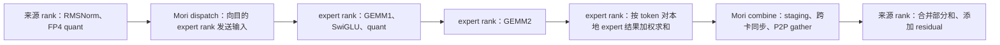
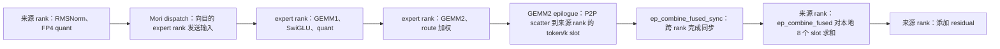
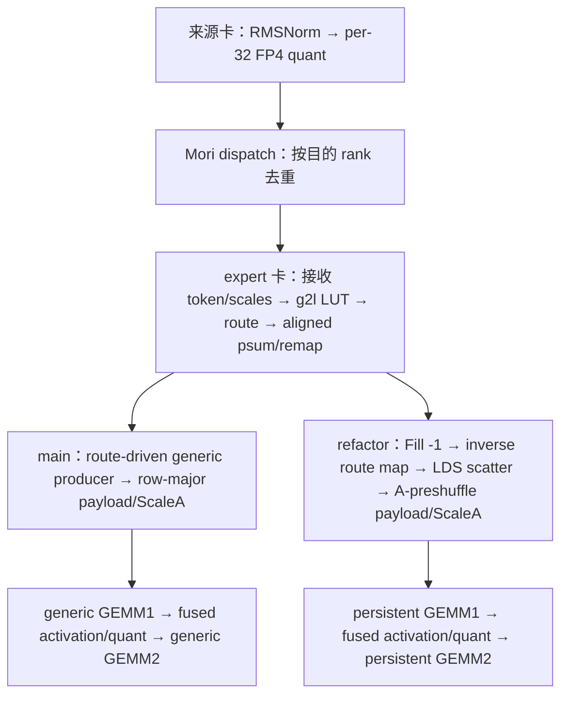

# MoE Framework Wiki：DSR1 DP4/EP4

本文包含两份独立说明：前半部分是 2026-10-13 调查的 DSR1 DP4/EP4 服务配置；后半部分是 2026-10-14 对 `bench_mega_moe.py`、E256/topk8/T1536 命令的通信说明，其中[第 11 节](#ep4-kernel-branch-comparison)补充 2026-10-15 对用户现有 main/refactor 日志的逐 kernel 对照。两者的 shared expert、routing 和代码版本分别以各自章节为准。

## DSR1：cudagraph、EP 通信与 GEMM1/GEMM2 dispatch（2026-10-13）

本文依据 `a07-3`（`yanguahe@heliosr-1b114-a07-3.mnb.dcgpu`）的 `dsr1_ep4` 容器中实际脚本、模型 config 和 ATOM/AITER 源码，说明下面两条命令对应的服务逻辑。本文适用于调查时的容器版本；升级框架或修改脚本、量化配置、环境变量、CSV 后需要重新核对。

**这套命令配置为 DP4/EP4，每个 DP rank 的 attention 使用 TP1。默认开启 `FULL` cudagraph：四个 rank 都执行 decode 时，各 rank 使用同一个 batch bucket，并分别 replay 自己的整模型图；任一 rank 执行 prefill 时，该轮所有 rank 都普通执行。MoE 使用本地 64 个 routed expert 加 1 个 shared expert，共 E65；源 token 的 dispatch topk 为 9，但 EP CSV 的 topk 查询 key 为 `-1`。当前 CSV 没有这组 DSR1 配置的匹配行，GEMM1/GEMM2 均使用默认 `t64/w1x4/b3`。**

### 调查命令与验证范围

服务端命令：

```bash
bash /app/scripts/dsr1/serve_dsr1fp4_a8w8_dp4ep4.sh \
  /data/models/DeepSeek-R1-0528-MXFP4-MTP-MoEFP4
```

benchmark 命令：

```bash
cd /app/ATOM/scripts/performance
bash /app/scripts/dsr1/bench_dsr1fp4.sh \
  /data/models/DeepSeek-R1-0528-MXFP4-MTP-MoEFP4
```

**本轮只读取脚本、源码、配置和包路径，并用本地标准库执行 CPU CSV 匹配查询。遵照用户“机器 hang，不能运行任何 GPU kernel”的要求，没有运行上述命令、服务、benchmark、GPU 监控、框架 import 或 GPU 测试，也没有重启、清理机器。** 因此，本文说明配置和代码路径，不宣称本轮已成功启动服务、完成 capture 或获得性能结果；旧 TP1 容器日志不作为 EP4 的运行证据。

下文使用四个实际 DP/EP rank 的正常部署路径。`FAKE_EPLB` 的少卡模拟分支会改变实际进程数和 all2all 路径（`engine_core_mgr.py:112–147`）；本轮未探测 GPU，也没有用模拟分支代替用户指定的 DP4/EP4 分析。

### 1. 服务配置、并行结构与 cudagraph 开关

#### 1.1. 服务脚本实际传入的参数

`/app/scripts/dsr1/serve_dsr1fp4_a8w8_dp4ep4.sh:62–63` 启动 `python -m atom.entrypoints.openai_server`，核心参数如下：

```text
-tp 4
--enable-dp-attention
--enable-expert-parallel
--kv_cache_dtype fp8
--block-size 64
--no-enable_prefix_caching
--no-enable-chunked-prefill
--online_quant_config '{"layer_quant_config":{"*.self_attn.q_b_proj":"mxfp4"}}'
--max-num-seqs 2048
--gpu-memory-utilization 0.975
--cudagraph-capture-sizes '[1,2,4,8,16,32,48,64,128,256,512,1024,1536,2048]'
```

脚本没有传入 `--enforce-eager`、`--cudagraph-mode`、`--method`、`--enable-tbo`、`--max-num-batched-tokens` 或 `--all2all-backend`。结合当前 CLI 默认值，实际配置为：

| 设置 | 此命令的值 | 说明与远端源码依据 |
|---|---|---|
| `enforce_eager` | `False` | `arg_utils.py:50` |
| `cudagraph_mode` | `FULL` | `arg_utils.py:252–256` |
| `level` | `3` | `arg_utils.py:248–250`；compile 不等于 graph replay |
| capture sizes | 以上显式传入的 14 个值 | 覆盖 CLI 默认列表，不是默认的 11 个值 |
| 每 rank `max_num_seqs` | `2048` | 脚本显式覆盖默认值 |
| 每 rank `max_num_batched_tokens` | `16384` | `arg_utils.py:385–390` |
| `scheduler_delay_factor` | `0.0` | `arg_utils.py:502–508`；另有默认启用的 DP PrefillDelayer，见第 7 节 |
| speculative/MTP decode | 未启用 | `method=None`，`speculative_config=None`，见 `arg_utils.py:340–351,686–712` |
| TBO | 未启用 | `arg_utils.py:714–717` |
| `moe_all2all_backend` | `auto`，正常四 rank 路径选 `mori` | `arg_utils.py:719–727`、`moe.py:213–229` |

`engine_core.py:144–147` 在非 eager、非 disaggregated decode 的初始化中调用 `capture_cudagraph`。这证明本命令走开启 capture 的配置分支，不代表本轮已经运行并验证 capture 成功。

#### 1.2. `-tp 4` 在 DP attention 下转为四个 TP1 DP rank

不能仅凭命令中的 `-tp 4` 判断模型仍按 TP4 分片。`engine_core_mgr.py:83–109,281–295` 将 DP attention 下的 TP ranks 转成独立 DP engines：原始 DP1 × TP4 转为 **DP4 × TP1，PP1**。

每个 DP rank 有自己的请求队列、scheduler、attention 和 KV cache，处理分配给该 rank 的请求。MoE 开启 EP 后跨四个 DP rank 分配 expert；`moe.py:323–339` 明确在 EP 中每个 rank 完整持有一组 expert，MoE 的 `tp_size=1`。因此本地 expert 的 `moe_intermediate_size` 仍为 **2048**，不因 CLI 的 `-tp 4` 变成 512。

#### 1.3. MTP 权重、fake routing 与关键环境变量

模型 config 有 `num_nextn_predict_layers=1`，路径名称也包含 `MTP`，但脚本没有传入 `--method mtp`。当前普通 decode 每个请求每步输入 **1 个 query token**，`qlen=1`，没有 MTP draft/verification forward 或对应的 draft graph。`--num-speculative-tokens` 的默认值本身不会激活 MTP。

脚本第 11–14 行默认 `FAKE_EPLB=1`，追加：

```bash
--fake-eplb --hf-overrides '{"num_hash_layers": 0}'
```

它让各 MoE layer 使用预生成的人工均衡 router logits。`fake_eplb` 与真正的 `eplb_enable` 是不同设置；本次没有开启真实 EPLB，后者默认 `False`（`config.py:2017`）。fake routing 不控制 cudagraph，也不使 dummy token 自动无效。

与本次 MoE 路径直接相关的环境变量为：

| 设置 | 脚本或当前源码的值 | 本次作用 |
|---|---|---|
| `AITER_USE_GROUPED_GEMM` | 脚本设 `1` | 使用 FlyDSL grouped MoE |
| `AITER_FORCE_A8W4` | 脚本设 `0` | gfx1250 下 MoE activation 使用 FP4，实际为 A4W4 |
| `ATOM_MOE_GU_ITLV` | 脚本设 `1` | 使用 gate/up interleaved weight layout |
| `ATOM_MORI_V2` | 脚本设 `1` | 选择 MoRI v2 接口 |
| `ATOM_MEGA_STAGE2_FUSED` | 当前源码默认 `1` | 绑定 AITER MegaMoE，GEMM2 epilogue 融合 EP scatter |
| `ATOM_MEGA_STAGE1_FUSED` | 脚本设 `0` | 使用 token-major dispatch，不走 compact stage1-fused 路径 |
| `MEGA_DISPATCH` / `MEGA_DISPATCH_WIRE` | 脚本设 `mori` / `fp4` | MoRI FP4 dispatch，携带 quant scale |
| `ATOM_FUSE_SHARED_EXPERT` | 当前源码默认 `1` | 满足量化条件时将本 rank 的 shared replica 融入 grouped MoE |
| `ATOM_MEGA_COMBINE_WIRE` | 当前源码默认 `bf16` | 本次 prefill/decode 都以 BF16 combine |
| `ATOM_DP_LM_HEAD_MODE` | 脚本设 `allgather` | uniform decode 使用 DP vocab 分工的 LM head，见第 8 节 |
| `ATOM_USE_TRITON_MLA` | 脚本设 `1` | attention backend 选择 Triton MLA |
| `ATOM_MLA_PAGE_SIZE` / `ATOM_USE_TRITON_MLA_SHUFFLE_KV` | 脚本设 `1` / `1` | MLA 使用 token-level page metadata；shuffled KV 存储仍要求 scheduler `--block-size 64` |

这里需要按当前源码区分旧变量名：脚本仍设 `ATOM_MORI_V2_FUSED=1`，但当前 transport 读取的是 `ATOM_MEGA_STAGE2_FUSED`，本次因其默认值为 1 而启用 Mega；脚本的 `MEGA_COMBINE_WIRE` 也不能代替 ATOM 实际读取的 `ATOM_MEGA_COMBINE_WIRE`。依据为 `envs.py:161–177`、`mori_v2_prepare_finalize.py:134–138,197–213`。MLA 的 page size 与 scheduler KV block size 也须区分，见 `aiter_mla.py:361–369`。调查到的容器环境没有对应外部覆盖。

脚本的 `ATOM_USE_TRITON_GEMM=1` 不等于启用 Triton MoE；`moe.py:1274–1290` 的默认 Triton MoE 判断排除 EP，本次 expert GEMM 仍走 FlyDSL grouped 路径。

### 2. prefill、统一 decode 与跨 rank 混合阶段

#### 2.1. 先同步各 rank 调度信息，再决定 bucket 和执行方式

`ForwardMode.decide` 在每步通过 CPU DP group 同步各 rank 的 `scheduled_tokens`、`scheduled_bs` 和 `is_prefill`。`ubatching.py:270–278` 得到全组请求数最大值及是否存在 prefill；`forward_context.py:278–311` 据此决定：

```text
B_max = max(各 rank 的 scheduled_bs)
统一 decode = 所有 rank 都没有 prefill
B_bucket = 最小的、满足 b >= B_max 的 capture size
use_cudagraph = 本 rank 非 prefill
                且全组统一 decode
                且非 enforce_eager
                且存在可容纳 B_max 的 capture bucket
```

因此，各 rank 不能各自仅按本地 batch size 选不同 bucket。`FULL` 表示整模型 capture 的范围，不表示 prefill 也会 replay。

| 本轮各 rank 的阶段 | 模型执行 | 模型 token 行数 | GEMM1/GEMM2 选择时机 |
|---|---|---|---|
| 全组 prefill | 每 rank 普通 forward | 各自实际调度的 prompt token 数 | 每次调用按当前 EP 接收 buffer shape 查询配置 |
| 有 rank prefill，其他 rank decode | 全部普通 forward | 各 rank 实际调度的 token 数，不统一为 decode token bucket | 每次调用查询配置；decode rank 本轮也不 replay |
| 全组 decode：capture | 每 rank 对同一组 bucket 分别执行并捕获 | 每 rank `B_bucket × qlen`，本次 `qlen=1` | capture 时执行 dispatch，可以为不同图选不同版本 |
| 全组 decode：replay | 每 rank replay 对应 `(B_bucket,1)` 图 | 每 rank `B_bucket`，包含源端 dummy 行 | 沿用捕获时的 kernel，不再执行 Python GEMM dispatch |

本地 scheduler 选到 prefill 时就返回该 batch，不再混入本地 decode；但四个独立 scheduler 仍可能在同一轮处于不同阶段。默认 PrefillDelayer 尽量协调 prefill，不保证消除所有跨 rank 混合轮次，见第 7 节。

普通执行分支见 `model_runner.py:2817–2819`，replay 见第 2980–2988 行。默认 FULL 不把 compiled pieces 包成 PIECEWISE `CUDAGraphWrapper`（`backends.py:423–448`），所以普通 forward 可能经过 `torch.compile`，仍不能称为 prefill graph replay。

#### 2.2. 源 token 数、接收 token 行数与 token-expert route 数

EP4 中至少要区分三个数量：

- **源端模型行数 `T_r`**：rank r 的 embedding/attention/MoE router 处理多少行 hidden states。统一 decode 的 graph 包含源端 dummy，`T_r=B_bucket`。
- **目标 rank 实际接收的 token 行数 `R_r`**：MoRI 按目标 rank 去重，同一源 token 在同一目标 rank 选中多个 expert 时，token payload 只占一行。`R_r` 不等于该 GPU 的有效 expert route 数。
- **本地 expert 的有效行数 `M_e`**：目标 rank 对其 65 个本地 expert 分别执行多少条 token-expert route；一行接收 token 可以对应多个本地 expert。

`mori_v2_prepare_finalize.py:644–668` 用 `sum(context.running_tokens_across_dp)` 给接收 buffer 提供静态行数上界；因为 dispatch 按目的 rank 去重，这个上界不需要乘 topk。Mega 在第 791–811 行对接收 token、IDs、weights 和 scales 按上界切片，再调用 grouped MoE。

capture 为对称的四 rank bucket，`model_runner.py:3895–3905,3927–3935` 将每 rank 的 token 数设置为 `B_bucket`，因此 **每张 decode 图捕获时的接收 buffer 上界为 `4 × B_bucket`**。实际 `R_r` 通过 GPU 上的 `total_recv` 变化，不会把已捕获的 buffer shape 改成 `R_r`。

需区分 capture 与运行时 Python metadata：`prepare_inputs` 在第 2354–2359、2424–2434 行传入同步到的原始调度 token 数；`set_forward_context` 在 `forward_context.py:953–955` 原样记录该数组。正常 replay 不重新执行 `_recv_bound`、Python 切片或 CSV 查询，使用 capture 固定下来的 `4 × B_bucket` shape。对本次 prefill/跨 rank 混合的普通执行，源模型没有统一 token padding，接收上界使用各 rank 实际调度 token 数之和。

### 3. graph bucket、真实 batch size 与 CSV token key

#### 3.1. capture sizes 的单位是每 rank 的请求位置数

这 14 个 capture sizes 表示每个 rank 预捕获的 batch bucket，不是四 rank 请求总数，也不是 prompt 长度列表。对本次普通 decode：

```text
rank r 的有效输入行数 = B_r × 1
每 rank 图的模型行数 = B_bucket × 1
四 rank 模型行数合计 = 4 × B_bucket
每 rank 图捕获时的 EP 接收 buffer 上界 = 4 × B_bucket
```

prefill 请求可以长短不同，因此其总 token 数应写成 `Σ L_i`。若以后显式开启固定 K 的本地 MTP verification，常见每请求 query 数为 `K+1`（anchor + K draft token），graph key 和 token 预算都需要重新核对，不能将本次 `qlen=1` 的表直接套用。

#### 3.2. EP4 的 CSV key 来自接收 buffer shape

`grouped_moe_gfx1250.py:1452–1486` 从传入的 `topk_ids.shape` 取得 token 行数。当前非 compact 的 Mega 路径传入的是已按静态接收上界切片的 `recv_ids`，不是本地源 token 数，也不是 GPU 上的实际 `total_recv`。随后 `_get_padded_m` 生成 CSV token key：

```text
M < 32768：next power of 2(M)
M >= 32768：按 [32768,131072] tiers，取不大于 M 的最大 tier
```

依据为 `grouped_moe_gfx1250.py:116–125`。例如普通执行的接收上界为 65536 时，当前函数的查询 key 是 32768。这个函数只生成配置 key，不把模型输入或接收 buffer 再补成该 key 的行数。

本次统一 decode 的完整映射为：

| 每 rank batch bucket B | 图 key | 每 rank 模型行数 | capture 时固定 EP 接收上界 | CSV token key |
|---:|---|---:|---:|---:|
| 1 | `(1,1)` | 1 | 4 | 4 |
| 2 | `(2,1)` | 2 | 8 | 8 |
| 4 | `(4,1)` | 4 | 16 | 16 |
| 8 | `(8,1)` | 8 | 32 | 32 |
| 16 | `(16,1)` | 16 | 64 | 64 |
| 32 | `(32,1)` | 32 | 128 | 128 |
| 48 | `(48,1)` | 48 | 192 | 256 |
| 64 | `(64,1)` | 64 | 256 | 256 |
| 128 | `(128,1)` | 128 | 512 | 512 |
| 256 | `(256,1)` | 256 | 1024 | 1024 |
| 512 | `(512,1)` | 512 | 2048 | 2048 |
| 1024 | `(1024,1)` | 1024 | 4096 | 4096 |
| 1536 | `(1536,1)` | 1536 | 6144 | 8192 |
| 2048 | `(2048,1)` | 2048 | 8192 | 8192 |

例如各 rank 有 `[63,50,40,32]` 个有效普通 decode 请求，`B_max=63`，全组选择 `(64,1)`。四个源 rank 各执行 64 行模型，分别有 `[1,14,24,32]` 行源端 padding；每张图捕获时 EP 接收上界为 256，CSV token key 为 256。不能以 rank 0 的 63 行或源端 64 行作为这条 EP CSV 查询的 token key。

如果客户端的 6144 个请求恰好全部处于 decode 且均衡分配为每 rank 1536 个，则使用 `(1536,1)`；capture 接收上界为 6144，CSV token key 为 8192。这是配置推导的例子，实际请求分配和 batch 序列没有实测。

#### 3.3. 63 个有效 token 的支持条件

在上述全组统一 decode、选择 64 bucket 的条件下，框架已经在进入模型/MoE 前准备 graph 所需的 64 行源输入。MoE 不需要先将源输入从 63 行扩成 64 行，但必须正确处理 64 行源 token 的 routing、EP dispatch、本地 partial-M、接收尾部 mask 和输出合并。

这不能推广成“MoE 只支持 1–512 中的 2 的幂就能覆盖服务”。本脚本还 capture 48、1536、2048 等 bucket；prefill/跨 rank 混合普通执行的源行数和接收上界可以是其他值，各 expert 的 `M_e` 也不保证是 2 的幂。

#### 3.4. 源端 padding、BOS 与 EP 接收尾部 padding

对正常稳态 PP1 decode，`tokenIDProcessor` 默认采用 deferred sampled-ID 路径（`model_runner.py:194`）。在模型 replay 之前，`prepare_input_ids` 的第 574–593 行调用 `fill_deferred_decode_ids`；`decode_input_ids.py:59–102` 将实际请求 token 范围以外的尾部 token ID 写成 0。

当前 `fill_to` 查找使用 `reversed(capture_sizes)`，而 capture 后列表按升序排序（`model_runner.py:4037–4038`），因此正常路径可能清零到最大 bucket 2048，超过本轮实际读取的 B。这里能确认的是 graph 读取的 padding 区域已准备合法 ID 0，不能把该实现描述成“恰好只补到 B”。`prev_batch is None` 还有第 508–513 行的直接返回分支，上面的具体填充流程针对正常稳态 decode。

框架也准备源端 dummy 的 attention metadata：

- `attentions/backends.py:610–634` 将尾部 `cu_seqlens_q` 填为实际总 query token 数，使 dummy 序列的 query length 为 0。
- 本次选择 Triton MLA（`selector.py:138–140`）；其 metadata builder 继承 AITER MLA builder（`triton_mla.py:34`）。`aiter_mla.py:2497–2504` 将 `slot_mapping` 初始化为 `-1`，只给有效 token 写真实 slot，尾部 `context_lens=0`；第 2553–2554、2573–2576 行填平尾部 KV offsets 并将 last-page length 设为 0。

模型 config 中 `bos_token_id=0`、`eos_token_id=1`、`pad_token_id=2`。**token ID 0 是合法 BOS，不天然表示无效 token。** 框架使用 0 准备 dummy ID buffer，dummy 的有效性仍由调度、attention metadata 和输出范围决定。

有效 TP1 的 `VocabParallelEmbedding.forward` 使用 `F.embedding(x,self.weight)`（`embed_head.py:171–181`）。同一 rank 的 dummy ID 0 与真实 BOS 刚经过 embedding 时都读取 `W_embed[0]`，向量相同，不保证为 0。后续 position、attention 上下文等可能不同，进入 MoE 的 hidden state 不要求相同，也没有因 dummy 身份自动清零。

源端 dummy 会经过图中的全部 transformer layers，并参加正常 MoE router/topk、FP4 dispatch、GEMM1/GEMM2 和 combine。attention 的 dummy qlen=0 不会自动成为 MoE 的源 token mask；MoE 接收整份源 hidden states，dummy 也使用 fake routing（`moe.py:5117–5131`），可以产生跨 rank routed expert 计算及本来源 rank 的 shared route。这里的“计算规则等价”不表示它与有效行具有相同数值或相同 expert。

**EP 接收 arena 的无效尾部是另一种 padding。** 目标 rank 实际接收到 R 行 token 后，buffer `[R,接收上界)` 没有对应的有效接收 token；Mega 将 GPU `total_recv` 传为 `num_local_tokens`（`mega_moe.py:855`），grouped EP route/mask 据此跳过这些无效行（`grouped_moe_gfx1250.py:693–772`）。源端 dummy 被正常 dispatch 后属于有效接收行，不能与这种 dead tail 混为一谈。

正常 replay 最后按 `scheduled_tokens` 截取 hidden states 和 graph logits（`model_runner.py:2980–2988`），sampling 再处理真实 batch，源端 padding 结果不会作为额外请求的输出。

没有真实请求的 DP rank 也不能随意退出集体执行：`engine_core.py:833–849` 会调用 `dummy_execution`，`model_runner.py:1135–1175` 构造 `Sequence(id=-1)`、token ID 0、普通 decode 的 1 行同步 batch，并设置 `is_dummy_run=True`。此处的 **request ID `-1` 与 token ID 0 是不同概念**，这批同步结果不对应真实用户请求。

### 4. 本地 expert、shared fusion 与实际 GEMM 配置

#### 4.1. 模型逻辑 expert 与 EP dispatch 空间

模型 config 的关键值为：

```text
hidden_size=7168
moe_intermediate_size=2048
n_routed_experts=256
num_experts_per_tok=8
n_shared_experts=1
n_group=8, topk_group=4
num_hidden_layers=61
first_k_dense_replace=3, moe_layer_freq=1
```

因此 target model 有 61 个 transformer layers，前 3 层为 dense，后 58 层为 MoE。每个 token 在每个 MoE layer 选择 8 个 routed expert，并执行 1 个 shared expert。

shared 与 routed expert 使用相同动态 per_1x32 FP4 activation/FP4 weight spec；checkpoint 的 exclude 不排除 target shared expert，脚本的在线量化 override 只改 `*.self_attn.q_b_proj`。当前 `ATOM_FUSE_SHARED_EXPERT` 默认 1，`topK.py:16–86` 的条件允许融合。

真实 EPLB 未启用时，`expert_layout.py:43–80` 选择 **`LOCAL_REPLICA`**：256 个 routed expert 按四 rank 分片，每 rank 再拥有同一 shared expert 的一个本地副本。因此应区分：

| 数量 | 本次含义 |
|---|---|
| 256 routed + 1 shared | 模型逻辑计算，不代表每 token 执行 257 个 expert |
| 260 physical dispatch slots | 256 routed slots + 4 个 shared replica slots |
| 每 rank E65 | 64 个完整 routed expert + 1 个 shared replica |
| 源 token dispatch topk9 | 先选 routed topk8，再追加 1 条来源 rank 的 shared route |
| EP CSV topk `-1` | 配置查询使用的 EP sentinel，不表示真实 route 数为负数 |

`moe.py:3378–3478,3549–3558` 构造本地 E65 权重、260 项 expert mask 和 topk9 dispatch；不能继续使用 TP1 文档的 E257/topk9 或 E256/topk8 作为本次本地 GEMM 的查询 shape。

#### 4.2. shared replica 如何映射、是否单独 GEMM

本次 `shared_expert_dispatch.py:29–60,106–159` 的映射为：

```text
routed checkpoint ID p → dispatch ID p + floor(p / 64)
rank r 的全部 dispatch slots = [65*r, 65*r+65)
rank r 的 shared dispatch ID = 65*r+64
```

| EP rank | routed checkpoint IDs | routed dispatch IDs | shared dispatch ID |
|---:|---|---|---:|
| 0 | 0–63 | 0–63 | 64 |
| 1 | 64–127 | 65–128 | 129 |
| 2 | 128–191 | 130–193 | 194 |
| 3 | 192–255 | 195–258 | 259 |

`moe.py:590–622,3658–3680` 先在 256 个 routed expert 中选 topk8，再 remap routed IDs，追加本来源 rank 的 shared ID。shared route 固定在来源 rank，本 rank 的 shared replica 只为本 rank 源 token 计算 shared 输出；不会因为收到其他 rank 的 routed token，就为这些 token 再加一次本地 shared 输出。

**当前 shared 融入 E65 的 grouped GEMM1/GEMM2，不走独立 shared MLP。** `deepseek_v2.py:1211–1226,1289–1299` 只在 shared fusion 关闭时创建并调用独立 `self.shared_experts`。融合后的每 token 仍是 8 routed + 1 shared 的逻辑运算，既不是每 token 计算所有 65 个本地 expert，也不是计算全部 260 个 dispatch slots。

#### 4.3. MoRI FP4 dispatch、GEMM 与融合 combine

实际包路径为 `/app/ATOM/atom`、`/app/aiter/aiter`、`/app/mori/python/mori`。当前正常四 rank 路径选择 MoRI v2 + AITER MegaMoE，`ATOM_MEGA_STAGE1_FUSED=0`，处理链为：

```text
来源 rank：hidden states → router/topk8 → dispatch-ID remap + shared route
→ MoRI 按目的 rank 去重、quant 为 FP4、发送 token 和 scale
→ 目的 rank：接收 token-major buffer，按本地 E65 路由和 expert M 对齐
→ grouped GEMM1 + SiLU/gating + 中间 activation quant
→ grouped GEMM2：epilogue 应用 route weight，P2P 写来源 rank 的 combine arena
→ combine：通信同步并按来源 token 汇总结果
```

`mori_v2_prepare_finalize.py:303–331` 显式选择 quantizing MoRI dispatch；第 771–797 行调用 Mega 全层执行。`mega_moe.py:791–862` 包含 dispatch、接收切片、`fused_moe` 和 combine；GEMM2 的 `stage2_scatter` 将按 route 加权的结果直接写入 peers 的 combine staging，所以不需要再把普通本地 MoE 完整输出交给单独的传统 combine 搬运。

MoE 源 token capacity 取每 rank scheduler 预算 16384（`fused_moe/config.py:369–396`）。Mega 接收 arena 容量为 `world_size × max_tokens_per_rank`（`mega_moe.py:402–403`），本次为 65536 行；每步/每张图另使用第 2、3 节的较小接收上界。这是容量与 shape 推导，不是本轮实测 VRAM。

`AITER_FORCE_A8W4=0` 在 `aiter/fused_moe.py:800–804` 选择 FP4 activation quant dtype。本次 MoE 实际为 **A4W4**；服务脚本名中的 `a8w8` 不能用来推断 expert GEMM 的数据格式。

#### 4.4. 当前 CSV 无匹配，两个 GEMM 都 fallback 到 t64/w1x4/b3

默认 CSV 为 `/app/aiter/aiter/configs/tuned_grouped_fmoe.csv`，调查版本含 **113 条 data rows**。未找到附加 grouped model CSV、CSV 路径覆盖或本次 TDM tile/warp/buffer 环境覆盖。

本次 grouped MoE 的配置查询包含：

```text
token_num = _get_padded_m(EP 接收 buffer 行数)
model_dim = 7168
inter_dim = 2048
experts = 65
topk = -1
activation = Silu
dtype = bf16
q_dtype_a = FP4，q_dtype_w = FP4
quant_type = per_1x32
ep_fused = True
```

不能只看 CSV 的 token 列；expert 数、I 维度、EP topk sentinel、量化和 `ep_fused` 等也须匹配。CPU 检查从当前源码 AST 提取 `_get_padded_m` 和 `_find_grouped_config` 等函数，以标准库替身提供 dtype、architecture 和 CSV 中 CU key，不 import 框架或查询设备。15 组查询全部无匹配；CSV 连 `model_dim=7168 / inter_dim=2048 / expert=65` 的候选行都没有，因此该结论不依赖本轮 GPU CU 探测。

| 调用范围 | 接收上界/CSV key | 本次 GEMM1 / GEMM2 |
|---|---|---|
| 全部 14 个 decode bucket | 见第 3 节表 | 无匹配 row，两阶段默认 `t64/w1x4/b3` |
| prefill、跨 rank 混合普通执行 | 接收上界为全组本轮源 token 数之和，最多 65536；再应用 `_get_padded_m` | 同一 E65/I2048 查询没有候选 row，两阶段默认 `t64/w1x4/b3` |

这里 `t64/w1x4/b3` 表示每阶段 `tile=(64,256,256)`、`(m_warp,n_warp)=(1,4)`、`num_buffers=3`。默认参数见 `grouped_moe_gfx1250.py:547–590`。无 row 时上层局部日志变量 `num_buffers=2` 不会传入 `_grouped_a8w4_tdm_moe`，调用使用函数默认 b3（第 1470–1472、1518–1547、1604–1629 行），不能把日志局部值当作实际 launcher 参数。

当前容器的 `grouped_gemm_mxfp4.py:74–195` 直接调用 `kernels/mxfp4_preshuffle_gfx1250_tdm.py`，没有旧容器的 optimized/persistent selector。**旧 TP1 文档中“token key 16384 切换 optimized t256”及其他 E64/topk8 开发树的 dispatch 结论，不适用于本次 E65、EP topk=-1 的配置。**

### 5. 在 cudagraph 下按 token 数选择不同 GEMM 的条件

机制上，GEMM1 和 GEMM2 可以分别配置不同 tile、warp、buffer 等参数；CSV 字段包括 `tile_m2/m_warp2/n_warp2/num_buffer_stage2`。二者共享 expert 连续行布局，必须满足 `max(tile_m,tile_m2)` 能被两个 tile M 整除（`grouped_moe_gfx1250.py:648–656`）。

prefill/跨 rank 混合普通执行每次调用 MoE 都经过配置查询，可以按本步 **EP 接收 buffer shape** 选择两个 GEMM 的版本。统一 decode 则在各 bucket 的 capture 期间选择版本；不同 bucket 图可以记录不同 kernel。但当前 CSV 没有匹配行，所有本次 bucket 和普通执行都使用同一套默认 GEMM 配置，不能描述成已经实现了 DSR1 的 token 分档切换。

同一张图 replay 时，输入值、实际 `R_r`、router logits、expert IDs、routing weights、各 expert 的 `M_e` 以及通信数据可以更新；已捕获的 kernel、launch 参数和 tensor shape 沿用 capture 结果。这些 GPU 数据变化不会重新运行 Python CSV/launcher dispatch，也不会自动把 GEMM1/GEMM2 换成另一版本。

若要按同一 bucket 内更细的真实 token 数或 routing 分布切换版本，需要增加预捕获的 bucket/图，并在图外明确选择，或实现相应图内 GPU 分派机制。当前 graph key 只有 `(running_bs,max_seqlen_q)`，不带有效 token 数或 kernel 版本。48 与 64 bucket 甚至共用 CSV token key 256，也不能仅靠 token key 区分这两张图的 GEMM 配置。

修改 CSV、dispatch 代码或编译环境后，已有图不能自动反映变化，需要重新加载缓存配置并重新 capture，通常由重启服务完成。此处只说明后续生效条件，本轮没有修改运行环境或重启服务。

### 6. prefill 长度分布对 attention 与 EP4 MoE 计算量的影响

#### 6.1. attention core 依赖每个请求的 query/KV 长度

同一个 prefill batch 中各请求长度可以不同。对没有历史 KV 的完整 dense prefill，固定 head 数和维度、各请求长度为 `L_i` 时：

```text
总 query token 数 T = Σ L_i
attention core 的主要理论运算量 ∝ Σ L_i²
causal query-key 有效对数 = Σ [L_i × (L_i+1) / 2]
```

| 两次 forward | 各请求长度 | T | Σ L_i² |
|---|---|---:|---:|
| A | `[512,512]` | 1024 | 524288 |
| B | `[256,768]` | 1024 | 655360 |

B 的平方项多 25%，但 causal 有效对数的比例并非恰好 25%，整个 attention 层或实际耗时也不能按该比例推断。线性投影、tile padding 和执行效率另有影响。存在历史 KV 时需使用各请求本轮 query 数与 KV 长度，不能仅看 prompt 总 token 数；本脚本明确关闭 chunked prefill 和 prefix caching。

上述是数学推导。ATOM scheduler 在 profiling 且启用 `ATOM_ENABLE_DETAILED_ANNOTATION` 时另统计每请求 query 平方项和 query×KV 项（`scheduler.py:3517–3558`），这些统计也不是实际 kernel 计时；本脚本的 `TRACE` 默认 0，不代表正常请求总会收集这些详细统计。

#### 6.2. MoE 的理论总运算量与每个 GPU 的工作量不同

设全组源模型行数为 `T_group=Σ_r T_r`，包括统一 decode 的源端 dummy。在同一模型层、每 token 固定 8 routed + 1 shared、expert 尺寸相同且没有丢弃 route 时：

```text
全组有效 token-expert route 总数 = 9 × T_group
```

因此，全组 T 相同可以确定全组理论有效 GEMM 运算量相同，不取决于这些 token 原来属于多少个请求。MoE 不按请求的 KV 长度计算 expert FFN。

但 **仅知道某个来源 rank 的 T，不能确定该 GPU 的 MoE 工作量**。EP4 的该 GPU 处理的是所有来源 rank 分配给它的本地 64 routed expert 的 routes，加上本来源 rank 的 shared routes；实际接收去重、expert 分布、通信流量和 expert tile padding 都可能不同。甚至全组 T 相同，但各来源 rank 的 T 分布不同，也会改变 shared replica 的负载及各 GPU 分工。

grouped GEMM 的实际 M tile 覆盖还受 `Σ_e ceil(M_e/tile_m)` 影响：128 条 routes 分布为 `[64,64]` 只需 2 个 tile，分布为 `[63,65]` 则需 3 个。这里 route 总数不变，但 padding 工作不同；当前实现用 `_align_m` 和 per-expert mask 做对齐，见 `grouped_moe_gfx1250.py:648–660`、`kernels/moe_contiguous_psum.py`。

#### 6.3. FAKE_EPLB=1 下的比较边界

`moe.py:136–189,3628–3645` 按 DP rank 生成交错的 fake routing 表，其中全局 token 索引形如 `t=dp_rank+i*dp_size`，并遵守模型的 group-limited routing；forward 使用本 rank 表的前 `hidden_states.shape[0]` 行（第 5117–5131 行）。

所以，在同一层、各来源 rank 的源模型行数逐项相同、执行模式和配置不变时，改变各 rank 内部请求长度分布不会通过真实 hidden states 改变 fake expert 分布，可将对应 expert/tile/dispatch 工作视为相同。GEMM 仍使用实际 hidden states，输出值不要求相同，耗时也不保证相同。

只要求全组 token 总数相同还不够：来源 rank 分配变化会改变 fake 表前缀组合和 shared 归属。比较 graph bucket 不同时也应计入不同的源端 dummy，不能只比较有效请求数。本节没有运行 GPU 性能对比，例子均为源码分析或理论计算。

### 7. 每次 prefill/decode 的 batch size 如何确定

#### 7.1. 先将客户端请求分配给 DP rank

客户端请求由 engine manager 分配到四个 DP rank，各 rank 的 waiting/running 队列独立。默认负载策略为 **`least_requests`**：优先在途请求最少的 rank，请求数相同再比较在途 prompt-token 负载，完全相同则按旋转游标解平局。源码为 `engine_core_mgr.py:36,900–928,984–1025`。

这不是固定 round-robin，也不能保证任意时刻 6144 个客户端请求恰好每 rank 1536 个。请求数包含等待、prefill、decode 等状态；真实每轮 batch 由各 rank scheduler 再决定。

每 rank 上限为 2048 个活跃 sequence、每轮新 query token 预算 16384，四 rank 理论活跃名额合计 8192。这个数不保证 KV cache 能容纳任意长度的 8192 个请求，实际还受模型长度、输出增长、KV 分配、preemption 和完成/取消等因素影响。

#### 7.2. prefill：完整 prompt 装入每 rank token 预算

当前没有 chunked prefill 和 prefix caching。正常新请求从 waiting 队列依次接纳，须满足 token 预算、活跃 sequence 名额、KV blocks 和静态长度等限制：

- `scheduler.py:1604–1610` 限制本轮 prefill 请求数及 token 总数。
- 第 1652–1654 行的 `if len(self.running) >= self.max_num_seqs:` 表示**已经满额时停止接纳**，将请求放回 waiting 队首并 `break`。不是写错比较号；继续接纳的数量条件是 `< 2048`，等于上限也不能再接纳。已有活跃请求会占用名额。
- 第 1778–1788 行在下一完整 prompt 装不进剩余预算时放回队首并结束接纳，不继续扫描后面的短请求填空。超过完整单步预算的输入还受第 1396–1410 行静态拒绝检查。
- 第 2594–2611 行将接纳的 prefill sequence 放入 running；第 2055 行直接返回 prefill batch，本 rank 本轮不再调度 decode。

设 rank r 本次 prefill 请求数为 `B_prefill,r`、各请求本轮输入长度为 `L_i`：

```text
T_prefill,r = Σ L_i
```

在新请求实际 prompt 长度均为 L、资源足够的简化场景：

```text
B_prefill,r ≤ min(
    本 rank 本轮已到达且可接纳的等待请求数,
    2048 - 接纳前本 rank 已有 running 请求数,
    floor(16384 / L)
)
```

若实际待 forward 的每个 prompt 恰为 1024 token，每 rank 每轮 prefill 最多 16 个，四 rank 理想同步装满最多 64 个请求。实际可以更小，且不是客户端 concurrency6144 的整批 prefill。prefill 的源模型使用实际 token 行数，不按 decode capture sizes 补齐；`running_bs` metadata 可能取 bucket 值，不代表 prompt token 行数也被补齐。

#### 7.3. DP PrefillDelayer 默认启用

`scheduler_delay_factor=0.0` 不能解释成“当前 DP4 没有 prefill 等待/合批机制”。`ATOM_ENABLE_PREFILL_DELAYER` 默认 1，DP engine 在 `engine_core.py:197–219,750–760` 初始化 PrefillDelayer；脚本没有关闭它。

当前默认目标 fill 为 0.9，hold 上限为 200 scheduler ticks，不增长阈值为 10 ticks，KV high watermark 为 0.9；partial 上限为 100 ticks，但本次不开 chunked prefill，通常不涉及该分支。固定 prefill 后 decode 保护间隔默认 0，queue-ms 与 token-usage-low-watermark 默认未启用（`envs.py:705–763`）。

`prefill_delayer.py:330–440` 跨 rank 汇总 pending tokens、decode 活跃数和 KV 等信息。第一次允许 prefill；全组没有 decode 时立即允许。有 decode 时通常等待所有 rank 可 prefill，且平均 pending token fill 达到 0.9；也会因 KV 高水位、连续 200 hold ticks 或已对齐但积累不增长 10 ticks 等条件释放。hold prefill 期间 scheduler 可以继续 decode。

这些 must-fire 条件可能在 rank 尚未对齐时释放，实际 KV 分配和队列变化也会影响结果，所以仍可能出现某 rank prefill、其他 rank decode；该轮统一 decode replay 不成立。200 ticks 不是 200 毫秒，也不是整个请求 TTFT 的硬保证。

#### 7.4. decode：从本 rank 可继续生成的活跃请求中选择

当本 rank 本轮没有选到 prefill 时，`scheduler.py:2057–2099` 才从 running 选择 decode：请求需完成 prefill、未结束并可扩展 KV；partial、阻塞或 preempted 的请求可能不参加本轮。

```text
B_decode,r ≤ min(
    本 rank 本轮可 decode 的活跃请求数,
    2048,
    floor(16384 / q_sched)
)
```

本次 `q_sched=qlen=1`，因此这两个配置中 sequence 上限 2048 先约束 decode；实际可因 KV、到达/完成、取消等因素减少。确定各 rank 的真实 batch 后，CPU DP metadata 同步再选最小容纳全组 `B_max` 的 graph bucket；bucket 不是调度必须凑满的真实请求数。

一个完整生成请求包含一次普通 prefill及多步 decode；其他请求会不断加入或退出合批，因此该请求 prefill 时和以后每步 decode 时的 batch 成员与数量不要求相同。

#### 7.5. benchmark 参数与 batch size 的关系

当前 `bench_dsr1fp4.sh:10–14,36–48` 在只传模型路径时采用：

| 客户端参数 | 本次值 |
|---|---:|
| `CONC` / `--max-concurrency` | 6144 |
| `--random-input-len` | 1024 |
| `--random-output-len` | 4096 |
| `--random-range-ratio` | 1.0 |
| `--num-prompts` | `CONC × 3 = 18432` |
| `--request-rate` | `inf` |
| `--ignore-eos` | 开启 |
| HTTP port | 8000 |

ratio1.0 使 random dataset 的目标采样长度固定为 1024/4096（`benchmark_serving.py:172–243`），但服务端实际 prompt 行数仍按最终 tokenizer/请求内容计算；第 7.2 节的 16 请求例子以实际待 forward 长度恰为 1024 为前提。

6144 表示客户端最多保持这么多请求在途，不固定每轮 prefill 或 decode batch 为 6144；18432 是整个 benchmark 的请求总数；4096 是每请求目标输出长度，不是单步 decode qlen 或 MoE 行数。只有在仅有这批请求、全部可 decode 且均衡分配等条件成立时，才可用每 rank 1536 的 bucket 例子。

`--backend=vllm` 只是客户端协议选择，服务端仍是 ATOM。benchmark 参数不改变服务的 cudagraph、EP、MTP 或 scheduler 配置。

### 8. FULL decode 图的范围与 DP LM head

#### 8.1. 每 rank 每 bucket 捕获一次整模型 forward

`model_runner.py:3999–4015` 在同一 graph context 中执行整段模型、输出写入，以及满足条件时的 logits：

```python
graph = torch.cuda.CUDAGraph()
with torch.cuda.graph(graph, self.graph_pool, stream=capture_ctx.stream):
    model_output = self.model(input_ids[:num_tokens], model_positions)
    outputs[:num_tokens] = model_output
    if self.logits_in_graph:
        graph_logits = self.model.compute_logits(outputs[:num_tokens])
self.graphs[(bs, max_q_len)] = graph
```

这是省略外围代码的源码摘录。每个 rank 保存自己的 `(B,1)` graph，四 rank 的图协同执行通信；不是一个跨四 GPU 的单一 graph 对象，也不是只把一个 MoE 或一个 transformer layer 作为标准 FULL graph 的边界。

`deepseek_v2.py:3345–3358,3385–3410` 在 PP1 下执行 embedding、全部 61 layers 和 final norm，其中 58 个 MoE 都在这次模型调用内。因此本次每 rank 图的范围可表示为：

```text
embedding
→ transformer layers 0–2：norm / attention / residual / dense MLP
→ transformer layers 3–60：norm / attention / residual / MoE
   每个 MoE 含 router/topk、shared remap、FP4 EP dispatch、E65 GEMM1/GEMM2、combine
→ final norm
→ outputs buffer 写入
→ DP LM head / logits
```

一张图可以含许多 kernel 和通信节点；整模型 capture 不意味着把全部算子融合成一个 kernel。同一图 replay 仍执行这些节点，但不重跑它们的 Python kernel 选择逻辑。

#### 8.2. 当前 LM head 在图内，并使用 DP vocab 分工

`model_runner.py:638` 的 `self.world_size` 取实际 `config.tensor_parallel_size`，DP attention 转换后为 1；第 3793–3798 行设置：

```python
is_tbo = self.config.enable_tbo and isinstance(self.model, UBatchWrapper)
self.logits_in_graph = self.world_size == 1 and not is_tbo
```

本次未启用 TBO，故 **`logits_in_graph=True`**。不能看到 CLI `-tp 4` 就推断 LM head 在图外。

脚本的 `ATOM_DP_LM_HEAD_MODE=allgather` 在全组统一 decode、有效 TP1、DP4、vocab 可整除时生效（`embed_head.py:355–427,458–462`）。模型 `vocab_size=129280`，每 rank 计算其中 `32320` 个 vocab logits：

```text
每 rank B 行 final hidden states
→ DP all-gather hidden，得到 4B 行
→ 本 rank 使用自己 vocab slice 做 GEMM，得到 [4B,32320]
→ 沿 vocab 维度 DP all-gather，得到 [4B,129280]
→ 保留本来源 rank 的 B 行 logits
→ replay 后再裁剪为真实 scheduled token 行
```

这个版本在每 rank 仍加载完整 LM head weight，运行时取 vocab slice；DP 分工不表示加载时已把权重存储缩为四分之一（`embed_head.py:350–353,421`）。相关 all-gather 和 GEMM 在本次 FULL decode 图内。

prefill或跨 rank 混合轮次不满足 uniform 条件，使用普通 replicated full-vocab head；prefill先取每请求最后一行 hidden state（`embed_head.py:255–266`）。不能让只有本地 decode 的 rank 在混合轮次自行进入固定大小 DP head collective。

#### 8.3. 图外工作与有效输出

请求分配、scheduler、CPU DP metadata 同步、本轮 token ID 和 attention metadata 准备在整模型图之前；sampling、停止条件、请求状态更新在图外。`model_runner.py:2980–2988` replay 后按 `scheduled_tokens` 裁剪 hidden states/logits。

图覆盖一次模型 forward，不覆盖一个请求从 prefill 到生成结束的完整生命周期，也没有一次捕获全部 decode iterations。上述范围针对当前标准 FULL、PP1、未启用 TBO/MTP 的配置；改用其他 graph mode 或并行方式后须重新核对。

### 证据与版本记录

所有结论以本次 `dsr1_ep4` 容器的静态快照为依据。完整材料位于工作区：

- [EP4 调查记录](../../.codex_tmp/dsr1_ep4_investigation/INVESTIGATION.md)：验证范围、关键推导及快照清单。
- [EP4 源码摘录](../../.codex_tmp/dsr1_ep4_investigation/SOURCE_EXCERPTS.md)：本文使用的远端原始路径、行号、源码、模型配置与 SHA256。
- [脚本与模型快照](../../.codex_tmp/dsr1_ep4_investigation/scripts_model.json)：两个脚本原文、模型 config 与过滤后的容器环境。
- [CPU CSV 匹配结果](../../.codex_tmp/dsr1_ep4_investigation/grouped_config_check.json)和[查询脚本](../../.codex_tmp/dsr1_ep4_investigation/check_grouped_config.py)：113 条 data rows、15 组查询及 bucket→接收上界→CSV key 映射；仅标准库，不访问 GPU。
- [远端源码本地镜像](../../.codex_tmp/dsr1_ep4_investigation/sources/)：快照源码，解包时逐文件校验 SHA256；本文引用的行号是远端原文件行号。

本次脚本及模型 config 的 SHA256 为：

```text
serve_dsr1fp4_a8w8_dp4ep4.sh
adb07e0b40f8bfa770a2d3c4ed39b3b493c01c7f9d3781772ae85e29510b3400

bench_dsr1fp4.sh
61859fbd23f89778b1657a9adc12765b6ff76a7c0aebbc38fcbead47d5dc1d6c

/data/models/DeepSeek-R1-0528-MXFP4-MTP-MoEFP4/config.json
65c8f5958031046fa63cd419b86e2f8e6d4d3155d76068eeacfb6313613df2d5
```

保留原 [TP1 文档](moe_framework_wiki.md) 作为独立部署说明。本次只修订 EP4 文档；没有将其结论反向写入 TP1 文档，也没有用旧 TP1 日志或 CSV 查询结果证明 EP4 的运行行为。

## 四卡 MoE benchmark 的通信流程（2026-10-14）

**每层的大块跨卡数据传输发生在两个环节：GEMM1 前的 dispatch，以及 expert 计算之后的结果回传。`base` 把结果回传放在 Mori combine 中；`fused` 把回传写进 GEMM2 epilogue，随后执行跨卡完成同步和来源卡上的求和。GEMM1 与 GEMM2 的矩阵计算都在 expert 所在卡上执行，中间的 2048 维 activation 保留在这张卡上。**

这里必须区分 token 的来源卡和 expert 所在卡。本命令使用 `AITER_MOE_EXPERT_BALANCE=True`，balanced routing 确实让同一 token 的 8 个 expert 落在同一个目标 rank，但这个目标 rank 不一定是 token 的来源 rank。每个来源 rank 的 1536 个 token 中，384 个交给本 rank 的 experts，另外 1152 个交给其它三个 rank，因而仍有 75% 的 token 需要跨卡去程和回程。切换到 `False` 后的多目的 rank routing、接收行数和回程流量见[第 10 节](#ep4-random-routing)。

### 1. 命令、配置和说明范围

```bash
export PYTHONUNBUFFERED=1

MORI_V2_KERNEL_BACKEND=hip \
MORI_EP_TOKOFF_EXT="${MORI_EP_TOKOFF_EXT:-0}" \
MEGA_DISPATCH=mori \
FLYDSL_DUMP_IR=0 \
MORI_GPU_ARCHS=gfx1250 \
FLYDSL_GPU_ARCH=gfx1250 \
AITER_FORCE_A8W4=0 \
AITER_MOE_EXPERT_BALANCE=True \
exec torchrun --standalone --nproc_per_node=4 \
"./op_tests/multigpu_tests/bench_mega_moe.py" \
-e 256 \
-k 8 \
-hd 7168 \
-id 2048 \
--layers 16 \
-tpr 1536 \
-q a4w4_mxfp4 \
--combine both \
--iters 20 \
--acc_verify 0 \
--profile_table 1 \
--dispatch_wire fp4
```

本节依据 `f01-1` 的 `dsr1_ep4` 容器 `/app/aiter_moe_a4w4_pr_refactor_wt` 中的 AITER/Mori 源码。2026-10-14 已核对本地与容器内 `bench_mega_moe.py`、`mega_moe.py` 的 SHA256 一致，并下载、校验 Mori 的相关实现。本轮只读取源码、执行 CPU routing/字节数核对和更新文档；此前 thread trace 与 kernel 优化任务继续暂停，没有启动新的 GPU 测试。

| 参数 | 对 MoE 计算的含义 |
|---|---|
| `--nproc_per_node=4` | 同一主机上启动 4 个 rank，每个进程绑定一张 GPU |
| `-e 256` | 全局 256 个 routed expert，expert 计算按 rank 分成 4 组，每组 64 个 |
| `-k 8` | 每个 token 计算 8 条 expert route，并按对应 routing weights 汇总 |
| `-tpr 1536` | 每个来源 rank 有 1536 个 token，全组共有 6144 个源 token |
| `-hd 7168 -id 2048` | 输入/最终输出宽度 7168，SwiGLU 后的中间 activation 宽度 2048 |
| `-q a4w4_mxfp4` | expert GEMM 的 activation 和 weight 使用 FP4，并带 per-32 的 E8M0 scales |
| `--dispatch_wire fp4` | 两条路径的 dispatch 都发送 packed FP4 activation 和对应 scales |
| `--combine both` | 先运行完整的 `base` 路径，再运行完整的 `fused` 路径；分别 capture、计时、输出表 |
| `--layers 16` | 一次 graph replay 串联 16 层 MoE、RMSNorm 和 residual，复用同一组 expert weights |
| `--iters 20` | 每条路径计时 20 次完整的 16 层 graph replay，另外还有 warmup 和 profile replay |
| `--acc_verify 0` | 跳过独立 fp32 reference 检查，dispatch 和 combine 仍正常执行 |
| `--profile_table 1` | 汇总各 rank 的 kernel 时间；汇报统计本身还有进程间通信 |

命令没有传 `--shared_experts`，当前默认值为 0，因此本测试只有 E256/topk8 的 routed experts。前文 DSR1 服务中的 E65 本地 expert 组、shared route 和 topk9 不属于本节配置。本测试也没有 attention、KV cache 或 LM head。

`--combine_quant` 的默认值读取 `COMBINE_QUANT`，环境中未设置时为 `none`，即 BF16 回传。此前这条 benchmark 的 `[cfg]` 已记录 `combine_quant=none`；下面的回程字节数采用这个条件。FP4 dispatch 不会自动使 combine 也变成 FP4。

### 2. 整个 MoE 层在计算什么

设来源 rank 上第 `t` 个 token 的输入为 `x_t`。省略量化、布局变换及舍入后，本测试一层的概念式为：

```text
u_t = RMSNorm(x_t)

对 k = 0..7，e = expert_id[t,k]：
    [gate, up] = u_t @ W1[e]^T       # W1[e]: [4096,7168]
    h[t,k] = SiLU(gate) * up         # [2048]
    z[t,k] = h[t,k] @ W2[e]^T        # W2[e]: [7168,2048]

moe_out[t] = sum_k routing_weight[t,k] * z[t,k]
x_next[t] = x_t + moe_out[t]         # [7168]，回到来源 rank
```

GEMM1 合并了 gate/up 两个投影，计算的 K 为 7168，合计输出 4096 维；SwiGLU 将其变成 2048 维中间 activation。GEMM2 的 K 为 2048，输出 7168 维。实际 grouped kernel 会按 expert 对 token rows 分组，并在相应位置量化、preshuffle 和处理 ScaleA。

一般模型会从本层 hidden states 计算 router scores 再选 topk。本 benchmark 的 `make_routings()` 在计时前保留每层的 IDs/weights；`AITER_MOE_EXPERT_BALANCE=True` 使用固定的 round-robin IDs，weights 仍为随机、按 token 归一化的值。graph replay 中会重做本层的 dispatch slot 分配和本地 route 映射，但不会从当前 hidden states 重新算真实 router/topk。

### 3. 来源卡和 expert 所在卡：为什么仍然需要通信

expert 计算使用下面的分组：

| expert 所在 rank | 全局 expert IDs |
|---:|---|
| 0 | 0–63 |
| 1 | 64–127 |
| 2 | 128–191 |
| 3 | 192–255 |

当前 balanced IDs 的代码为：

```python
balanced_ids = (
    torch.arange(ct * topk, device=dev, dtype=torch.int64) % E
).reshape(ct, topk)
```

代入 `topk=8 / E=256`，以每个来源 rank 的本地 token 编号 `t` 计算：

```text
expert_id(t,k) = (8*t+k) % 256
expert_rank(t,k) = expert_id(t,k) // 64
                 = (t // 8) % 4          # 对该 token 的 k=0..7 都相同
```

64 可被 8 整除，所以这里每组连续的 8 个 expert 不会跨越 64-expert 的 rank 边界。IDs 中没有加来源 rank 的偏移，四个来源 rank 都使用相同的这套 expert-ID 分布；它们持有的 token 数据是各自不同的。

例如，**来源 rank0 的 token `t=8` 选 expert64–71，全部在 rank1**。它的完整逻辑是：

```text
rank0 的 token8
    -> rank0 量化输入
    -> dispatch：rank0 -> rank1
    -> rank1 的 expert64–71 执行 GEMM1/SwiGLU/GEMM2
    -> 结果回传：rank1 -> rank0
    -> rank0 求得该 token 的 MoE 输出，添加 residual，进入下一层
```

如果是来源 rank1 的 token `t=8`，expert64–71 已在来源 rank1，payload 的去程/回程可以留在本卡。决定是否有跨卡 token payload 的条件是 `expert_rank != source_rank`，而不是“同一 token 的 experts 是否彼此在同一张卡”。即使 payload 留在本卡，每层协议仍有跨 rank 的计数/完成同步。

对于完整的 T1536，本地 token 编号每 32 个形成一次目的 rank0、1、2、3 的循环。每个来源 rank 向每个目的 rank 分派 384 个不同 token，矩阵如下：

| 来源 rank \ 目的 expert rank | 0 | 1 | 2 | 3 | 本卡 token | 跨卡 token |
|---:|---:|---:|---:|---:|---:|---:|
| 0 | 384 | 384 | 384 | 384 | 384 | 1152 |
| 1 | 384 | 384 | 384 | 384 | 384 | 1152 |
| 2 | 384 | 384 | 384 | 384 | 384 | 1152 |
| 3 | 384 | 384 | 384 | 384 | 384 | 1152 |

因此每个目的 rank 有 1536 个有效接收 token，每个 token 在该 rank 上执行 8 个 expert，共 12288 条本地 expert route；每个 expert 恰好获得 192 条 route。全组共 6144 个源 token、49152 条 expert route，其中 4608 个源 token 的目的 expert rank 是远端，占 75%。以上由 CPU 枚举核对，不是运行时通信 counter 的测量。

这一“每 token 只有一个目的 expert rank”的结论适用于当前 balanced routing 实现和参数。关闭 balance、用随机 topk 时，同一 token 的 8 个 expert 可以分布在多个 rank，需要向多个目的 rank dispatch；具体变化见[第 10 节](#ep4-random-routing)。一般 MoE 也没有每 token 只访问一个 expert rank 的限制。

### 4. 通信环节一：GEMM1 前的 dispatch

dispatch 将计算送到持有相应 expert weights 的 rank。`base` 使用 Mori 的 `EpDispatchCombineOp.dispatch()`；`fused` 在 MegaMoE 内通过 Mori `EpDispatchPlan` 启动 HIP/JIT dispatch。`MEGA_DISPATCH=mori` 在本命令中选择后者，`MORI_V2_KERNEL_BACKEND=hip` 选择 Mori op 的 HIP backend。

dispatch 的主要动作是：

1. 来源 rank 对本地 RMSNorm 输出做 per-32 FP4 quant，得到 packed activation 和 scales。
2. 根据 expert ID 求目的 rank，并对同一 token 的重复目的 rank 去重。同一目的 rank 只接收一份 token activation，随后在本卡把它交给多个本地 expert。
3. 在目的 rank 的接收 arena 分配 slot，写入 activation、scales、topk expert IDs、routing weights，以及来源 rank/token 的反向映射。
4. 各 rank 交换本层发送计数和完成信号，目的 rank 确认接收数据可供 GEMM 使用。

其中 slot 分配涉及跨 GPU 的 allocator/atomic，完成信号也涉及小块跨卡访问。`MORI_EP_TOKOFF_EXT="${MORI_EP_TOKOFF_EXT:-0}"` 在变量未设置或为空时使用 0；若已有非空值则保留原值。它选择 slot allocator 的实现，不会取消 EP dispatch 或 combine。

每份有效输入的 FP4 payload 为 `7168/2 = 3584 B`，E8M0 scales 为 `7168/32 = 224 B`。Mori 接收 ScaleA 的实际 row pitch 对齐到 256 B，接收端要按这个 pitch 读取；224 B 是有效 scale 宽度，不能拿它当接收行跨度。expert IDs/weights 和来源映射也是传输内容，而本地 prefix sum、expert alignment 和 preshuffle 是接收后的本卡处理。

本测试在 `AITER_MOE_EXPERT_BALANCE=True` 时，8 条 expert route 只有一个目的 rank，因此 dispatch 每个 token 的 activation 只发送一次；“选 8 个 expert”不等于“输入跨卡发送 8 份”。目的 rank 在分组时生成 8 条计算 row，ScaleA/activation 可以在本地按 kernel 布局展开。`False` 同样按目的 rank 去重，但同一个 token 可以向多张卡各发送一份输入。

### 5. expert 卡上的 GEMM1、SwiGLU 和 GEMM2

dispatch 完成后，每个 rank 只为属于自己的 64 个 expert 计算收到的有效 routes。GEMM1、SwiGLU、GEMM1 输出 quant、GEMM2 读取中间 activation 都发生在这个 rank。

GEMM1 与 GEMM2 之间不需要把 2048 维中间 activation 发往其它 GPU。本测试也没有把单个 expert 的 W1/W2 按四卡拆开的 Tensor Parallel 矩阵计算，因而这两个投影之间没有 TP all-reduce。

`fused` 的 GEMM2 要另外承担 epilogue 的 P2P scatter，见下一节。其矩阵计算依旧是本地 expert 计算；含通信的输出写回属于这个 kernel 的执行时间。

### 6. 通信环节二：两种 combine 如何把结果送回来源卡

#### 6.1. `base`：expert 卡先汇总，再由来源卡 P2P gather



普通 grouped MoE 在 GEMM2 后执行本地 gather/reduce，生成目的 rank 的 token 部分和：

```text
partial[expert_rank,t] = sum_{k: expert_rank(e[t,k]) == expert_rank}
                            routing_weight[t,k] * z[t,k]
```

Mori combine 将这些 BF16 部分和放入 expert rank 的通信 arena，同步各 rank，然后**由来源 rank 从目的 expert rank 的 arena 做 P2P read/gather**，汇总它曾发送到的不同 rank 的部分和。当前 HIP intranode 实现为 `UseP2PRead=true`。同一 token 对同一目的 rank 的多条 route 已在本地相加，只读回一份 7168 维部分和；dedup 的其它目的 slot 是空项，不会重复累计。

在本测试的 `AITER_MOE_EXPERT_BALANCE=True` 条件下，每 token 只有一个目的 expert rank，所以这个部分和已经是它 8 个 expert 的完整结果。远端 token 需要读回一份 BF16 的 7168 维向量。`False` 时，来源 rank 需要汇总所有已访问 expert rank 的部分和，才能得到完整的 8-expert 结果。

#### 6.2. `fused`：GEMM2 按 route 直接 P2P scatter，来源卡最后求和



MegaMoE 给 GEMM2 传入 `Stage2ScatterContext`。GEMM2 根据 EP row map 获取每条 route 的来源 rank、token/k slot 和 weight，在 epilogue 中计算加权结果，并通过 indexed TDM store **主动写到来源 rank 的 combine arena**：

```text
source_rank.comb_inp[t*8+k] = routing_weight[t,k] * z[t,k]
```

来源 rank 与 expert rank 不同时是 P2P write，相同时是本 GPU 的输出写入。每条 expert route 有独立 slot，本路径不先把同一 token 在 expert rank 上的多条 route 汇总成一个向量。因此普通 grouped MoE 的本地 gather/reduce被跳过，MegaMoE 直接消费这些已写回的 slots。

随后 `ep_combine_fused_sync` 向各 peer 写 phase flag，并等待本 rank 的 peer slots 达到本次 phase，以完成本层的跨 rank rendezvous。GEMM2 的输出完成约束和这个同步一起保证后面的 reduce 使用本层数据。

最后的 `ep_combine_fused` 从**来源 GPU 本地** `comb_inp` 读 8 个 slots，在 FP32 累加后输出 BF16。因为 route weight 已在 GEMM2 中应用，这里执行不加权的 slot 求和。该 reduce 的大块数据读取是本地读取；本层的大块回程通信已在前面的 GEMM2 scatter 中发生。

因此，`fused` 的跨卡输出传输可以随各个 GEMM2 tile 的完成而推进；来源卡上的最终 reduce仍要等本层结果准备好。是否获得整体收益要看真实 overlap、同步和流量，不能只根据 kernel 合并或名字推断。

#### 6.3. 相同逻辑输出，回传粒度和有效 payload 不同

| 比较项 | `base` | `fused` |
|---|---|---|
| 回程方向的发起者 | 来源 rank 发起 P2P read，从 expert rank 取回 | expert rank 的 GEMM2 发起 P2P write，写到来源 rank |
| 本地 expert 的结果何时相加 | 回程前，在 expert rank 上按 token 加权求和 | 回程后，在来源 rank 上对每条 route 的 slot 求和 |
| 每 token 对每个目的 rank 的回传粒度 | 一份该 rank 的 expert 部分和 | 每条 expert route 各一份加权结果 |
| 大块回程通信的 kernel | `mori_ep_combine_tdm_bf16_*` | GEMM2 的 `_epscatter` epilogue |
| 回程完成同步 | Mori combine 内的跨卡 barrier | `ep_combine_fused_sync_*` |
| 来源卡最终求和 | Mori combine 内的 gather/reduce | `ep_combine_fused_*` 的本地 slot reduce |

在本测试的 `AITER_MOE_EXPERT_BALANCE=True` routing 和 `combine_quant=none` 条件下，按**每个来源 rank 每层**计算，1152 个远端 token 的有效 payload 为：

| 环节 | 远端传输的逻辑行数 | 每行有效 payload | 合计有效 payload |
|---|---:|---:|---:|
| FP4 dispatch，两条路径相同 | 1152 份 token | 3584 B FP4 + 224 B scales | 4,386,816 B，约 4.184 MiB |
| `base` BF16 回程 | 1152 份部分和 | `7168*2 = 14336 B` | 16,515,072 B，15.75 MiB |
| `fused` BF16 回程 | `1152*8 = 9216` 份 route 结果 | `7168*2 = 14336 B` | 132,120,576 B，126 MiB |

**这里在 `AITER_MOE_EXPERT_BALANCE=True` 时，fused 回程的有效 payload 是 base 的 8 倍。** 这是从当前源码的输出粒度和本测试 routing 计算出的逻辑数据量；不包括 metadata、ScaleA padding、slot 空隙、控制消息、协议/cache 事务等开销，也不是实测链路 counter。`False` 的期望流量及比例见[第 10.4 节](#ep4-random-routing-payload)；采用其它 routing 或 quantized combine 时也需要重新计算。不能由这个字节比直接推算 kernel 耗时比、链路饱和或具体硬件队列瓶颈。

这也解释了为什么评估 `_persist_epscatter` 不能只和普通 GEMM2 时间比较：前者包含回程写入和相关等待，后者之后还有本地 gather/reduce 与 Mori combine。评价两条完整路径要看 MoE e2e，或比较包含这些工作的完整 stage2。

### 7. profile 中哪些名字包含通信

以下名字用于对应工作位置，具体 GEMM 配置仍取决于当次代码、CSV、环境和 capture 时选中的 launcher：

| kernel/事件 | 负责的工作 | 是否包含跨 GPU 数据传输 |
|---|---|---|
| `mori_ep_dispatch_tdm_fp4x2_ws4_h3584_k8_*` | slot 分配、FP4 token/scale/route 发送、接收计数和完成信号 | 是；其中同 rank 的 token 属于本地分支 |
| GEMM1，名字含 `K7168`、`act1_q1` | expert gate/up 投影、SwiGLU、输出 quant | 本地 expert 计算 |
| 普通 GEMM2，名字含 `K2048`、`_persist` | expert down projection，写本地 grouped output | 本地 expert 计算 |
| GEMM2，名字含 `K2048`、`_persist_epscatter` | expert down projection、route 加权、向来源 rank scatter | 是，远端输出传输计入 GEMM2 时间 |
| `mori_ep_combine_tdm_bf16_ws4_h7168_k8_*` | base staging、跨卡同步、P2P gather、部分和汇总 | 是 |
| `ep_combine_fused_sync_*` | peer phase flag 写入和完成等待 | 是，小块控制通信及等待 |
| `ep_combine_fused_*`，不含 `sync` | 从本地 combine slots 读取，求和得到本 rank token 输出 | 该 reduce 的大块数据处理在本卡 |

profile 中的名字含 `scatter`、`gather` 或 `reduce`，本身不足以判断是跨卡通信。本地 route/preshuffle 也会 scatter/gather；RMSNorm 中的 feature reduction 也是本地计算。应根据它访问的是 peer arena 还是本地内存判断。

`--profile_table` 给出各 rank 的每 kernel 平均时间，其中通信 kernel 的等待会受其它 rank 的到达时间影响。多个 kernel/stream 的工作可能重叠，因此不能把逐 kernel 平均耗时简单相加当作完整 graph replay 的 wall-clock。

### 8. 数据面通信以外的同步和配置

`torchrun --standalone` 建立进程 rendezvous。脚本的 `Dist` 使用 Gloo process group，广播 Mori communicator UID，并汇总各 rank 的时间、profile rows 等对象/标量；初始化、capture 和计时边界还调用 communicator barrier。这些是 setup、执行协调或汇报通信，与每层运送 expert 输入/输出的 EP 数据面通信分别理解。

每层的 dispatch 计数/完成信号，以及 combine 的完成同步，属于 MoE 运行协议，随 graph replay 正常执行。即使 graph 已 capture，也要实际完成本次 token 数据传输和同步；capture 只固定 launch 流程，不会把通信变成一次性 setup。

`PYTHONUNBUFFERED=1` 只控制 Python 日志输出，`FLYDSL_DUMP_IR=0` 控制 IR dump，两个 `gfx1250` 变量指定编译目标。它们不改变 EP 的去程/回程逻辑。`AITER_FORCE_A8W4=0` 与 `-q a4w4_mxfp4` 选择 FP4 activation；历史 kernel 名称的 `a8w4_` 前缀不能单独作为 activation 实际为 FP8 的证据。

### 9. 源码依据和验证边界

AITER 主要依据：

- [bench_mega_moe.py](../op_tests/multigpu_tests/bench_mega_moe.py)：`make_routings()`、`DeviceMoEPipeline.setup()`、`_layer_step()`、`resolve_combine_modes()` 和 CLI 默认值。
- [mega_moe.py](../aiter/ops/flydsl/kernels/mega_moe_gfx1250/mega_moe.py)：`forward()`、`_build_mori_dispatch()`、`_scatter_context()` 和 `_combine()`。
- [grouped_moe_gfx1250.py](../aiter/ops/flydsl/grouped_moe_gfx1250.py)：`enable_ep_scatter` 跳过普通本地 gather/reduce；非 scatter 路径的 `flydsl_moe_gather_reduce()` 应用本地 routing weights。
- [grouped_gemm_mxfp4.py](../aiter/ops/flydsl/grouped_gemm_mxfp4.py)：第 10 节补充核对的当前本地 launcher，包含 `_balanced_expert_routing_enabled()`、A-preshuffle 准入条件及 `auto_balanced_m192`。
- [gemm2_scatter.py](../aiter/ops/flydsl/kernels/mega_moe_gfx1250/gemm2_scatter.py)：peer/slot 输出索引和 indexed TDM store。
- [combine.py](../aiter/ops/flydsl/kernels/mega_moe_gfx1250/combine.py)：`_make_combine_fused_sync()` 的 peer phase 协议和 `_make_combine_fused_reduce()` 的本地 topk sum。

Mori 的容器源码已选择性归档到 [moe_ep4_communication_20261014](../../.codex_tmp/moe_ep4_communication_20261014/)：

- [dispatch_combine_op.py](../../.codex_tmp/moe_ep4_communication_20261014/dispatch_combine_op.py)：combine 接口、BF16 gather 配置及 routing handle。
- [hip_backend.py](../../.codex_tmp/moe_ep4_communication_20261014/hip_backend.py)：HIP plan 绑定、combine launcher 和 tokoff-ext 开关。
- [ep_intranode_kernel.hpp](../../.codex_tmp/moe_ep4_communication_20261014/ep_intranode_kernel.hpp)：`EpDispatchBody()` 的目的 rank dedup、metadata/payload 发送；`EpCombineBody()` 的 staging、cross-device barrier 和按去重映射 gather。
- [ep_intranode_1250x.hpp](../../.codex_tmp/moe_ep4_communication_20261014/ep_intranode_1250x.hpp)：gfx1250 TDM dispatch/combine，`UseP2PRead=true` 与 PULL/gather 实现。
- [source_manifest.json](../../.codex_tmp/moe_ep4_communication_20261014/source_manifest.json)和[source_validation.json](../../.codex_tmp/moe_ep4_communication_20261014/source_validation.json)：远端原路径、逐文件 SHA256 核对及 CPU routing/有效 payload 计算。

已核对本地/远端一致的 AITER 文件 SHA256：

```text
op_tests/multigpu_tests/bench_mega_moe.py
7fcd3c186d489c0af645c6a22cdfb50c382984bc7e3934e17527611ec20975b3

aiter/ops/flydsl/kernels/mega_moe_gfx1250/mega_moe.py
4896053f9a6954a3ce55a13e5dab50a3a5c2a9c34780dfa6cc0eaf35ed67343f
```

硬件术语以本地 [CDNA5 ISA](../../mi400_hw_wiki/raw/papers/mi400_hd_txt/MI450/amd-instinct-cdna5-instruction-set-architecture.txt) §10.11–10.11.1，印刷页139–140为依据：TDM 在 memory 和 LDS 间移动 tile，可以与其它 shader instructions 并行；同 wave 的 Tensor instructions 按序完成，跨 wave 及相对其它 memory instructions 无序。**一条指令是 TDM 并不自动意味着跨卡**；本节的跨卡判断来自源码 descriptor/pointer 所选择的 peer GPU 地址。未由此断言具体物理链路、带宽或硬件队列状态。

<a id="ep4-random-routing"></a>

### 10. AITER_MOE_EXPERT_BALANCE=False 时的 token routing（2026-10-14）

把第 1 节命令中的 `AITER_MOE_EXPERT_BALANCE=True` 改为 `False` 后，**IDs 从固定 round-robin 改为随机 scores 的 topk，同一 token 的 8 个 expert 通常分布在 3–4 个目的 rank。** expert 归属仍为每卡连续 64 个；输入按访问到的不同目的 rank 各发送一份，结果仍回到 token 的来源 rank。

#### 10.1. IDs、weights 和每层 replay 的变化

`bench_mega_moe.py` 的 `main()` 读取这个环境变量，再把 `expert_balance` 传给 `make_routings()`。关闭 balance 时，每个来源 rank、每层生成 routing 的逻辑为：

```python
gen = torch.Generator(device=dev).manual_seed(
    4242 + 100 * source_rank + args.seed + layer_idx
)
score = torch.rand(1536, 256, generator=gen, device=dev, dtype=torch.float32)
_, ids = score.topk(8, dim=-1)
wts = torch.rand(1536, 8, generator=gen, device=dev, dtype=torch.float32)
wts = wts / wts.sum(dim=-1, keepdim=True).clamp_min(1e-9)
```

| 行为 | `True` | `False` |
|---|---|---|
| expert IDs | `expert_id(t,k)=(8*t+k)%256` | 每 token 从 256 个随机 scores 中选最高的 8 个不同 expert |
| 同一 token 的目的 rank | `(t//8)%4`，只有一个 | `ids[t,k]//64`，可以有 1–4 个不同 rank |
| 不同来源 rank 的 IDs | 四个 rank 使用相同的 round-robin IDs | seed 含来源 rank，各 rank 使用不同随机序列 |
| 不同层的 IDs | 每层使用相同的 round-robin IDs | seed 含 `layer_idx`，每层使用不同随机序列 |
| routing weights | 独立随机值，按 token 归一化 | 同样为独立随机值，按 token 归一化 |
| expert/rank 负载 | 本规模下精确均衡 | 均匀随机抽样下期望均衡，单次分配会波动 |

这些 random scores 是 benchmark 合成的数据，不依赖本层 hidden states。weights 也不是 scores 的 softmax；它们由另一次 `torch.rand()` 生成。`False` 在生成 weights 前先消耗 scores 的 RNG，因此即使 `args.seed` 相同，切换开关后的 weights 实际数值也不能假定相同。

routing 在 graph capture 前生成并保留，`--combine both` 的 `base` 和 `fused` 共用这组 per-layer IDs/weights。20 次计时 replay，以及 warmup/profile replay，都重用已经生成的 routing；每次 replay 重新执行 dispatch、expert 计算和 combine，但不会每个 iteration 重抽 topk，也没有把真实模型 router 的计算耗时加入 graph。

#### 10.2. 多目的 rank dispatch 与两种 combine

以**来源 rank0** 的一个 token 为例，假设选中的 IDs 如下。这是便于解释的示意，不是当前固定 seed 的实际样本：

```text
expert IDs = [3, 44, 71, 118, 136, 181, 205, 247]

rank0: expert3、44       -> 2 条本地 expert routes
rank1: expert71、118     -> 2 条 expert routes
rank2: expert136、181    -> 2 条 expert routes
rank3: expert205、247    -> 2 条 expert routes
```

dispatch 按 `(source token, destination rank)` 去重。这个 token 共产生四份输入：rank0 本地一份，向 rank1、2、3 各跨卡发送一份；同一 rank 的两个 expert 共享收到的 token 输入。每份输入仍携带完整的 8 个 IDs/weights，接收端将 global expert IDs 映射到本地，只为本 rank 拥有的 routes 分配 grouped rows。

Mori 将重复目的 rank 的 dispatch handle 设为 null，是为了避免重复输入和重复 combine 部分和。属于其它 rank 的 routes 会在当前接收 rank 上屏蔽，再由对应 rank 计算；这些处理保留了全局 8 条 expert route。

该例的回程为：

| 路径 | rank0 本地结果 | 从 rank1、2、3 回到 rank0 的结果 |
|---|---|---|
| `base` | 两个本地 expert 的一份加权部分和 | 每个远端 rank 先将两个 expert 的结果加权求和，各回传一份，共三份部分和 |
| `fused` | 两条本地 route 各写一个 `comb_inp[t*8+k]` slot | 每个远端 rank 的 GEMM2 各写回两条 route，共六份 route 输出 |

来源 rank 最后仍得到 8 个 expert 的加权总和。通信位置沿用前面的流程：GEMM1 前 dispatch，expert 结果计算后回传；GEMM1→GEMM2 的中间 activation 保留在 expert 卡。

#### 10.3. 输入复制数、接收行数和 expert 负载

下面使用理想模型：256 个 scores 独立、同分布且连续，topk 等价于从 256 个 expert 中均匀抽取 8 个不同 expert。实际 `torch.rand(float32)` 的固定 seed 样本未在本轮运行；表中的 `False` 数值是组合概率的理论期望。

对任意指定 rank，它拥有 64 个 expert，一个 token 至少访问它一次的概率为：

```text
q = 1 - C(192,8) / C(256,8)
  = 0.9035535764

E[不同目的 rank 数/token] = 4*q = 3.6142143056
E[远端目的 rank 数/token] = 3*q = 2.7106607292
```

这里 `C(n,k)` 表示组合数。不同目的 rank 数的理论分布为：

| 一个 token 访问的目的 rank 数 | 概率 |
|---:|---:|
| 1 | 0.004322% |
| 2 | 2.081000% |
| 3 | 34.403604% |
| 4 | 63.511074% |

因此约 97.9147% 的 token 访问 3–4 张卡。对给定来源 rank，8 个 expert 全在来源卡上的概率是 `C(64,8)/C(256,8)`，约 0.00108044%；至少有一条远端 route 的概率约 99.99891956%。**“几乎所有 token 都有跨卡 route”和“远端 expert route 比例期望为 75%”是两个不同统计口径。** 后者来自每条 route 落在四个 rank 的均匀边际概率。

对于每层 T1536、四卡 E256/topk8：

| 统计项 | `True` 精确值 | `False` 理论期望 |
|---|---:|---:|
| 每 token 的不同目的 rank 数，含本卡 | 1 | 3.6142 |
| 每 token 的远端目的 rank 数 | 平均 0.75 | 2.7107 |
| 至少有一条远端 route 的 token 比例 | 75% | 99.99891956% |
| 远端 expert route 占全部 routes 的比例 | 75% | 75% |
| 每来源 rank→指定目的 rank 的不同 token 份数 | 384 | 1387.8583 |
| 每目的 rank 的有效接收 token rows | 1536 | 5551.4332 |
| 每目的 rank 的本地 expert routes | 12288 | 12288 |
| 每个 expert 的有效 routes | 192 | 192，标准差约 13.6382 |

`False` 的单次实际 counts 是整数，且随来源 rank、层和随机抽样变化，不能把这些小数期望值当成固定 seed 的 routing 矩阵。表中接收 rows 的推导为 `4*1536*q`，来源→指定目的 rank 的输入份数为 `1536*q`。

接收 arena 的静态上界仍是 `max_recv=world_size*tpr=6144`；每个源 token 最多在任意一个目的 rank 占一行。全组每层仍有 6144 个源 token 和 `6144*8=49152` 条有效 expert route。输入复制数增加，接收后的每个 token row 通常只展开成其中属于本卡的几条 route，所以有效 expert 总计算量不会按输入复制数同比增加。

<a id="ep4-random-routing-payload"></a>

#### 10.4. 远端有效 payload 的变化

仍取 `--dispatch_wire fp4`、`combine_quant=none`，按**每来源 rank、每层，仅远端有效 payload**计算。每份 dispatch 输入含 3584 B FP4 和 224 B 有效 scales；BF16 输出向量为 `7168*2=14336 B`。

| 环节 | `True` 精确有效 payload | `False` 理论期望有效 payload |
|---|---:|---:|
| FP4 dispatch，含有效 scales | 4.184 MiB | 15.1204 MiB |
| `base` BF16 部分和回程 | 15.75 MiB | 56.9239 MiB |
| `fused` BF16 逐 route 回程 | 126 MiB | 126 MiB |

`True` 每来源 rank 有 1152 份远端 token 输入；`False` 的远端 `(token,peer)` 输入份数期望为 `1536*3*q=4163.5749`。dispatch 和 `base` 部分和回程按这个份数计算，期望有效字节数均增加到原来的约 **3.6142 倍**。

`fused` 仍为每条有效 route 写回一份结果。`False` 每来源 rank 的远端 route 数期望为 `1536*8*3/4=9216`，与 `True` 的精确值相同，所以远端有效 payload 的期望仍为 126 MiB；实际远端 route 数会波动。输入变为多目的 rank 分发，并不会再将同一条 expert 输出重复回传多次。

因此，**fused/base 的期望远端有效 payload 之比**由 balanced 时的 8 变为 `9216/4163.5749≈2.2135`。这说明输出回传粒度的差异仍存在，但在随机 routing 下 `base` 需要回传更多 rank 的部分和。

上述数值不包括 metadata、ScaleA padding、slot 空隙、控制消息和实际协议/cache 事务；3.6142 和 2.2135 都是有效字节量的推导，不能作为 kernel 耗时比或 MoE e2e 的性能测量。

#### 10.5. expert padding 与 launcher 也需要重新核对

`False` 不再保证每个 expert 恰好 192 条 route。若仍采用两阶段 `tile_m=tile_m2=192`，expert rows 仍按 192 对齐；例如某个 expert 从 192 增至 193 条有效 route，就需要两个 M tiles，并为 384 行预留对齐区间。有效 route 总量固定，不代表 padding、实际 M-tile 数和各 rank 耗时相同。

当前本地 [grouped_gemm_mxfp4.py](../aiter/ops/flydsl/grouped_gemm_mxfp4.py) 还将该环境变量用于以下 launcher 条件：

- `_supports_gfx1250_a_preshuffle_resolved()` 对相应 GEMM1 fused-quant 和 GEMM2 的 `t256/w2x4` A-preshuffle 特化要求 balanced routing；`False` 会关闭这部分准入。相应 `t192/w2x4` 条件不要求 balance 为 `True`，仍需满足其它 shape/layout 条件。
- 在 `tile_m=256`、`n_experts=64`、`contiguous_m=28672` 且没有显式覆盖 `balanced_m192` 时，`auto_balanced_m192` 还要求该开关为真。这个自动特化在 256 行布局内按 192 行计算；`False` 会关闭自动启用，避免把随机 expert 负载当成固定 192 行。

这些是当前本地源码中的选择条件。具体四卡运行仍取决于 CSV、环境覆盖、输入布局和当次 launcher；本次没有运行 `False` 的 GPU benchmark，不能据此宣称一定使用某个 persistent kernel、精度已经通过或性能有确定变化。

组合概率、负载期望和 payload 数值已由仅用 Python 标准库的[计算脚本](../../.codex_tmp/moe_ep4_communication_20261014/route_random_expectation.py)核对，结果保存在 [random_route_expectations.json](../../.codex_tmp/moe_ep4_communication_20261014/random_route_expectations.json)。这份结果是理想均匀抽样的数学期望，不是实际 GPU RNG routing 或性能数据。

<a id="ep4-kernel-branch-comparison"></a>

### 11. main 与 moe_a4w4_pr_refactor_wt 的四卡 kernel 列表逐项对照（2026-10-15）

本节使用用户已生成的 `dsr1_ep4:/app/aiter_moe_a4w4_pr_refactor_wt/moe_ep4_perf.log`，逐项核对完整 symbol 和两边容器工作区源码。**每种 combine 模式，main 有 19 个 GPU kernel，refactor 有 20 个；其中 15 个 GPU symbol 相同，4 个被替换，refactor 额外增加 1 个 inverse route map kernel。** 两边还各有 3 个 HIP host API 事件。主要变化来自 GEMM1/GEMM2 的 t192 A-preshuffle persistent 接入、接收后的输入 producer 和 LUT 实现；Mori dispatch 与 base/fused combine 的通信逻辑保持一致。

此前对固定空格筛选的表述在这里精确更正：`egrep "kernel    avg_us"` 漏掉的是 refactor 的两张 **base** 表，refactor 的 **fused** 表仍能匹配。

#### 11.1. 日志对应的运行顺序和代码来源

用户脚本按 `main → refactor → refactor → main` 顺序运行，每轮均包含 `base` 和 `fused`。脚本在每次调用前设置 `PYTHONPATH=$PWD`，日志中的 AITER `.so` 路径也分别落在对应仓库，支持这四轮分别使用了指定目录的代码。

| run | 容器内工作目录 | 工作区所属分支及随后读取的 HEAD | base / fused 表头行 |
|---:|---|---|---|
| 1 | `/app/aiter` | `main`，`e212581c0477a58dbd2c164176e950198c651143` | 30 / 64 |
| 2 | `/app/aiter_moe_a4w4_pr_refactor_wt` | `moe_a4w4_pr_refactor_wt`，`e749e6cef3392295f7a1c491a1d9f51a1b75bbb2` | 126 / 161 |
| 3 | 同 run2 | 同 run2 | 224 / 259 |
| 4 | 同 run1 | 同 run1 | 327 / 361 |

**refactor 目录包含此前四卡双 persistent 接入的未提交补丁。** 以下结果描述的是这个实际工作区，不能全部归因于纯 `origin/moe_a4w4_pr_refactor_wt` 的 commit 内容。源码为读取时的快照；日志中的 symbol 则是运行时证据。同一分支两轮的完整 symbol 集合一致。

四轮 `[cfg]` 相同：

```text
world=4 layers=16 tokens/rank=1536 hidden=7168 inter=2048
E=256 topk=8 EPR=64 quant=a4w4_mxfp4 combine=both
dispatch=mori stage1_fused=False dispatch_wire=fp4 combine_quant=none
force_a8w4=0 gate=INTERLEAVE shared_E=0 expert_balance=True
data_init=norm seed=0 gfx=gfx1250
```

这里的 `stage1_fused=False` 是 benchmark 的 dispatch/stage1 模式设置，并不表示 GEMM1 内部没有融合 activation 和 quant。两边实际 GEMM1 的 symbol 都有 `act1_q1`。expert IDs 在 capture 前生成；profile 内没有重新计算真实模型 router 的 topk kernel。

本节只读取已有日志、源码及文件 hash，并运行 Python 标准库的 CPU 解析/计算。日志没有附带当时 GPU 空闲前后检查，且命令为 `--acc_verify 0`：耗时是用户已有记录的整理，不作为本轮新完成的受控性能或精度验证。

#### 11.2. 为什么直接查看文本表会觉得差异更大

两边 `bench_mega_moe.py` 的计算、routing、capture、计时和 profile 汇总逻辑一致；相关 diff 只有 `_emit_table()` 的默认列宽及其说明文字，main 为 120，refactor 为 72。refactor 的长 GEMM 名、ATen 模板名因此更早显示成 `…`/`...`，完整 symbol 仍在每张表后面的 machine-readable JSON 行中。

| 显示/统计问题 | 现有日志中的具体情况 | 正确理解 |
|---|---|---|
| 固定 4 个空格匹配 | main 四张表、refactor 两张 fused 表是 `kernel    avg_us`；refactor 两张 base 表是 `kernel   avg_us` | 原 `egrep` 漏掉 refactor base，不代表该模式没有运行 |
| `-A 21` 固定截取行数 | main 每表 22 个事件，refactor 每表 23 个事件 | 会截掉最后的 HIP API 行；不是完整 kernel 列表 |
| 长名字截断 | refactor 列宽只有 72 | 不能把截断后看起来相同/不同的前缀直接当作完整 symbol 比较 |
| 行顺序变化 | 表按各 rank 平均的累计 self device time 排序 | 不是按 `avg_us` 排序；多次执行的小 kernel 也可能排在单次更慢的 kernel 前面 |
| `calls` 为小数 | 例如 45.75、46.25 | 它是四个 rank 的 profiler 事件计数平均，不是一个 rank 执行了小数次 kernel |
| profile 次数与计时次数 | 默认 `prof_replays=3`，而 `--iters=20` 用于另一个计时窗口 | 每层一调用的理论 profile 次数是 `3*16=48`；本日志实际捕获计数部分低于 48，不能仅由此断言少算了层或 routes，日志本身未确定差额来源 |

只读查看已有文本表可用：

```bash
grep -E 'kernel[[:space:]]+avg_us' -A 24 moe_ep4_perf.log
```

本节的逐项对照以完整 JSON 为准，保存在 [comparison.json](../../.codex_tmp/f01_1_ep4_kernel_compare_20261014/comparison.json)。`avg_us` 是先分别计算各 rank 的每次调用平均 self device time，再取这些平均值的算术平均，不是把总时间除以跨 rank 总 calls 的加权均值。

#### 11.3. 完整逐项映射

下表覆盖两种模式的全部自定义 GPU kernel。K01–K06 是两分支真正的 symbol 替换/新增；K07–K15 是相同 symbol 的对应工作。K15 使用便于辨认的 C++ 模板片段，完整 symbol 和逐项映射另存于 [kernel_mapping.json](../../.codex_tmp/f01_1_ep4_kernel_compare_20261014/kernel_mapping.json)。

| 编号 | 模式 | main | refactor | 具体工作及差异 |
|---|---|---|---|---|
| K01 | base / fused | `a8w4_tdm_fp4_t256x256x256_w1x4_b4_K7168_e64_act1_q1r8_cluster1x4_prefetch_mg10_planarlds_interleavelds_rolleddrain` | `a8w4_tdm_fp4_t192x256x256_w2x4_b4_K7168_e64_act1_q1r6_cn4_cm1_prefetch_apre_persist` | GEMM1；gate/up 投影、activation 和 GEMM2 输入 FP4 quant 均已融合。切换 tile、wave geometry、输入/输出布局和跨 N-task 调度，详见 11.4。 |
| K02 | base | `a8w4_tdm_fp4_t256x256x256_w2x2_b3_K2048_e64_prefetch_mg10_planarlds_interleavelds_rolleddrain` | `a8w4_tdm_fp4_t192x256x256_w2x4_b4_K2048_e64_cn4_cm1_prefetch_apre_persist` | 普通 GEMM2；写本卡 grouped BF16 output。generic t256/w2x2/b3 改为 A-preshuffle persistent t192/w2x4/b4，详见 11.5。 |
| K03 | fused | `a8w4_tdm_fp4_t256x256x256_w2x2_b3_K2048_e64_prefetch_epscatter_mg10_planarlds_interleavelds_rolleddrain` | `a8w4_tdm_fp4_t192x256x256_w2x4_b4_K2048_e64_cn4_cm1_prefetch_apre_persist_epscatter` | GEMM2 加 route 加权及 P2P scatter；两边都已有这段通信。变化是矩阵调度与 epilogue 的 tile/slice 实现，详见 11.5。 |
| K04 | base / fused | `moe_fused_quant_preshuffle_routeks_fd7168_r16_fp4_pk8_srctk8_noKS_pq256_rm` | `moe_scatter_preshuffled_a_fd7168_r32_lds_pe7_slds_skipempty_ss256` | 接收后的本卡输入转换由 route 驱动的 row-major producer，改为 inverse map 驱动的 LDS 转置/A-preshuffle producer；两边都复用已量化 FP4 输入，详见 11.6。 |
| K05 | base / fused | 无 | `moe_invert_route_rows_tk8` | refactor 新增 grouped_row→接收 token row 的 inverse map；供 K04 连续处理 grouped rows，不是跨卡通信，详见 11.6。 |
| K06 | base / fused | `moe_g2l_lut_n512_w32` | `moe_g2l_lut` | global→local expert LUT 的语义相同；main 用两级 wave prefix，refactor 用双 buffer LDS 的 9 轮 Hillis-Steele scan，详见 11.7。 |
| K07 | base / fused | `mori_ep_dispatch_tdm_fp4x2_ws4_h3584_k8_64x8` | 同左 | GEMM1 前按目的 rank 去重，传送 FP4 token、scales、IDs/weights，更新接收 slot 和完成状态。两边 symbol 相同，Mori 协议和 wire 配置相同。 |
| K08 | base / fused | `moe_route_g2l_lds` | 同左 | 接收端把 global expert ID 转为 local ID，为有效本地 routes 分配 expert rows，生成 gather weights/counts；dropped routes 与 dead-tail 被屏蔽。源码相同；其后按 256/192 对齐的布局不同。 |
| K09 | base | `moe_contiguous_psum_remap` | 同左 | 对 per-expert counts 做 tile 对齐的 prefix sum，并将 route row 重映射到 contiguous grouped rows。源码和 symbol 相同，tile_m 参数从 256 变为 192，故 starts/psum 与 padding 区间不同。 |
| K10 | fused | `moe_contiguous_psum_remap_ep` | 同左 | 完成 K09 的本地 prefix/remap，同时写 ep_rowmap 的来源 rank/token/topk-slot 及 weight bits，供 GEMM2 scatter 使用。源码相同，expert alignment 参数不同；本 kernel 只构造本地 metadata。 |
| K11 | base | `moe_gather_reduce_bf16_d7168_tk8_sk1_v4_wbf16_frlds` | 同左 | 本卡从 grouped GEMM2 output 收集同一接收 token 的 local expert routes，加权求和成部分和。源码相同，输入 row offsets 来自各自的 256/192 布局；它本身不跨卡。 |
| K12 | base | `mori_ep_combine_tdm_bf16_ws4_h7168_k8_64x8` | 同左 | base 回程：staging/同步后由来源卡 P2P gather 各 expert rank 的 BF16 部分和并汇总。两边 symbol、通信参数和协议相同。 |
| K13 | fused | `ep_combine_fused_sync_0` | 同左 | fused 回程的 peer phase flags 和完成等待；确保 GEMM2 写回的 slots 可供下一步 reduce 使用。两边 combine.py 字节相同；不同上游到达时间可以改变等待耗时。 |
| K14 | fused | `ep_combine_fused_0` | 同左 | 来源卡对本卡 comb_inp 的 topk slots 做最终求和。两边 combine.py 字节相同；大块跨卡写回已经发生在 K03，此 reduce 的数据处理在本卡。 |
| K15 | base / fused | `dynamic_per_group_scaled_quant_kernel<BF16, FP4, 32, …>` | 同左 | 来源卡在 Mori dispatch 前对每个本地 token 做一次 per-32 FP4 quant。两边使用相同的 BF16→FP4、group_size=32、shuffle_scale=False 路径；与 K04 接收后的 layout 转换是不同工作。 |

两边都存在的 ATen kernel 逐项如下。表中使用唯一识别片段；每项的**完整** symbol 在两分支中相同，见上述映射文件及下面的展开列表。它们来自相同 benchmark 的 RMSNorm、residual 和初始化，不是新增的 expert GEMM 或通信。

| 编号 | 模式 | main | refactor | 具体工作及差异 |
|---|---|---|---|---|
| A01 | base / fused | `reduce_kernel<512, 1, …MeanOps…>` | 同左 | RMSNorm：对 7168 个 feature 的平方求 mean；两边 shape、算式及完整 symbol 相同。 |
| A02 | base / fused | `vectorized_elementwise_kernel<4, …pow_tensor_scalar_kernel_impl…>` | 同左 | RMSNorm：xf.pow(2)；两边算式及完整 symbol 相同。 |
| A03 | base / fused | `vectorized_elementwise_kernel<4, …bfloat16tofloat32_copy_kernel_cuda…>` | 同左 | RMSNorm：x.float()，BF16→FP32；两边 shape、dtype 及完整 symbol 相同。 |
| A04 | base / fused | `vectorized_elementwise_kernel<4, CUDAFunctorOnSelf_add<float>, …>` | 同左 | RMSNorm：mean + eps，eps=1e-6；两边算式及完整 symbol 相同。 |
| A05 | base / fused | `vectorized_elementwise_kernel<4, …rsqrt_kernel_cuda…>` | 同左 | RMSNorm：torch.rsqrt(mean + eps)；两边算式及完整 symbol 相同。 |
| A06 | base / fused | `elementwise_kernel_manual_unroll<128, 4, …MulFunctor<float>…>` | 同左 | RMSNorm：xf 乘归一化因子；两边都是 FP32 MulFunctor，完整 symbol 相同。 |
| A07 | base / fused | `vectorized_elementwise_kernel<4, …bfloat16_copy_kernel_cuda…>` | 同左 | RMSNorm：n.to(x.dtype)，FP32→BF16；两边 shape、dtype 及完整 symbol 相同。 |
| A08 | base / fused | `vectorized_elementwise_kernel<8, CUDAFunctor_add<c10::BFloat16>, …>` | 同左 | 每层的 x + y residual；shared_E=0，两边都没有额外 shared-expert FFN，完整 symbol 相同。 |
| A09 | base / fused | `vectorized_elementwise_kernel<4, FillFunctor<int>, …>` | 同左 | int32 buffer 初始化；完整 symbol 相同，但 refactor 额外执行 rows_to_tokens 的 torch.full(-1)，同一 symbol 的事件次数约翻倍，详见 11.6。 |

表内另有三个 host API 事件，两边也逐项对应：

| 编号 | 模式 | main | refactor | 具体工作及差异 |
|---|---|---|---|---|
| H01 | base / fused | `hipDeviceSynchronize` | 同左 | HIP host 同步 API；两边 profile 中各记录 2 次，avg_us=0 指 device self time，不代表 host 等待免费。 |
| H02 | base / fused | `hipGraphLaunch` | 同左 | HIP host graph launch API；两边各记录 3 次，与默认 prof_replays=3 一致，不是 --iters=20 的逐 kernel 计数。 |
| H03 | base / fused | `hipStreamIsCapturing` | 同左 | HIP host capture 状态查询 API；两边各记录 3 次，device self time 为 0，不是 GPU 计算 kernel。 |

按这些映射逐个核对，八张 profile 表中的每个事件都恰好对应一项说明，main 为 `19 GPU + 3 HIP`，refactor 为 `20 GPU + 3 HIP`。后文的耗时表只列 GEMM1、GEMM2 和通信链相关项；最终 `ep_combine_fused_0` 是通信完成后的本地 reduce，其位置和跨卡属性见 K14。

<details>
<summary>ATen 与来源卡 FP4 quant 的完整 C++ symbol</summary>

```text
K15
void aiter::dynamic_per_group_scaled_quant_kernel<std::bfloat16_t, opus::fp4_t, 32, 32, false, 256, true, false, 0, false, false, false, false, false>(opus::fp4_t*, float*, std::bfloat16_t const*, float const*, long, int, int, long, int const*, int)

A01
void at::native::reduce_kernel<512, 1, at::native::ReduceOp<float, at::native::MeanOps<float, float, float, float>, unsigned int, float, 4, 4> >(at::native::ReduceOp<float, at::native::MeanOps<float, float, float, float>, unsigned int, float, 4, 4>)

A02
void at::native::vectorized_elementwise_kernel<4, at::native::(anonymous namespace)::pow_tensor_scalar_kernel_impl<float, float>(at::TensorIteratorBase&, float)::{lambda(float)#1}, std::array<char*, 2ul> >(int, at::native::(anonymous namespace)::pow_tensor_scalar_kernel_impl<float, float>(at::TensorIteratorBase&, float)::{lambda(float)#1}, std::array<char*, 2ul>)

A03
void at::native::vectorized_elementwise_kernel<4, at::native::bfloat16tofloat32_copy_kernel_cuda(at::TensorIteratorBase&)::{lambda(c10::BFloat16)#1}, std::array<char*, 2ul> >(int, at::native::bfloat16tofloat32_copy_kernel_cuda(at::TensorIteratorBase&)::{lambda(c10::BFloat16)#1}, std::array<char*, 2ul>)

A04
void at::native::vectorized_elementwise_kernel<4, at::native::CUDAFunctorOnSelf_add<float>, std::array<char*, 2ul> >(int, at::native::CUDAFunctorOnSelf_add<float>, std::array<char*, 2ul>)

A05
void at::native::vectorized_elementwise_kernel<4, at::native::rsqrt_kernel_cuda(at::TensorIteratorBase&)::{lambda()#2}::operator()() const::{lambda()#2}::operator()() const::{lambda(float)#1}, std::array<char*, 2ul> >(int, at::native::rsqrt_kernel_cuda(at::TensorIteratorBase&)::{lambda()#2}::operator()() const::{lambda()#2}::operator()() const::{lambda(float)#1}, std::array<char*, 2ul>)

A06
void at::native::elementwise_kernel_manual_unroll<128, 4, at::native::gpu_kernel_impl_nocast<at::native::BinaryFunctor<float, float, float, at::native::binary_internal::MulFunctor<float> > >(at::TensorIteratorBase&, at::native::BinaryFunctor<float, float, float, at::native::binary_internal::MulFunctor<float> > const&)::{lambda(int, bool)#1}>(int, at::native::gpu_kernel_impl_nocast<at::native::BinaryFunctor<float, float, float, at::native::binary_internal::MulFunctor<float> > >(at::TensorIteratorBase&, at::native::BinaryFunctor<float, float, float, at::native::binary_internal::MulFunctor<float> > const&)::{lambda(int, bool)#1})

A07
void at::native::vectorized_elementwise_kernel<4, at::native::bfloat16_copy_kernel_cuda(at::TensorIteratorBase&)::{lambda(float)#1}, std::array<char*, 2ul> >(int, at::native::bfloat16_copy_kernel_cuda(at::TensorIteratorBase&)::{lambda(float)#1}, std::array<char*, 2ul>)

A08
void at::native::vectorized_elementwise_kernel<8, at::native::CUDAFunctor_add<c10::BFloat16>, std::array<char*, 3ul> >(int, at::native::CUDAFunctor_add<c10::BFloat16>, std::array<char*, 3ul>)

A09
void at::native::vectorized_elementwise_kernel<4, at::native::FillFunctor<int>, std::array<char*, 1ul> >(int, at::native::FillFunctor<int>, std::array<char*, 1ul>)
```

</details>

#### 11.4. GEMM1：真正换了 kernel 家族、wave geometry 和两端布局

```text
main:
a8w4_tdm_fp4_t256x256x256_w1x4_b4_K7168_e64_act1_q1r8_cluster1x4_prefetch_mg10_planarlds_interleavelds_rolleddrain

refactor:
a8w4_tdm_fp4_t192x256x256_w2x4_b4_K7168_e64_act1_q1r6_cn4_cm1_prefetch_apre_persist
```

| 项目 | main 实际运行 | refactor 实际运行 | 逻辑含义 |
|---|---|---|---|
| GEMM 数学 shape | 每 expert，K7168，gate/up 合计 N4096 | 相同 | activation 后产生 2048 维中间输入 |
| tile_m / tile_n / tile_k | 256 / 256 / 256 | 192 / 256 / 256 | M tile 改为贴合本测试每 expert 的 192 条有效 routes |
| m_warp / n_warp | 1 / 4 | 2 / 4 | 4 waves 改为 8 waves，workgroup threads 从 128 改为 256 |
| 每个 M wave 覆盖的 M 行 | 256 | 96 | `wmma_m_rep=tile_m/m_warp/16`，从 16 改为 6；输入 ScaleA 和 accumulator 的行映射随之改变 |
| num_buffers | 4 | 4 | `b4` 表示输入 pipeline buffer 数；不等于 persistent task 数 |
| cluster | `cluster_m=1, cluster_n=4` | 相同，写成 `cn4_cm1` | 两边均是同一 GPU 内 4 个 N 方向 workgroups，不是四个 EP rank |
| 输入 payload/ScaleA | generic payload；本次输入 producer 的 ScaleA 为 row-major | A-preshuffled payload、canonical M32 ScaleA | refactor 使用独立的 retained optimized/persistent launcher |
| 输出 | activation + FP4 quant，供 generic GEMM2 | activation + FP4 quant，直接写 GEMM2 A-preshuffle 布局 | 两边都已有融合；变化在存储布局和调度 |
| `q1r8` / `q1r6` | `stage1_quant_out=1, quant_wmma_rep=8` | `stage1_quant_out=1, quant_wmma_rep=6` | 该 repeat 描述 GEMM2 所需的输出 scale 布局参数；不是 topk 或 GPU 数 |
| N-task 调度 | 本次 `persistent_workers=0`；一个 task 对应各自的 M/N tile 工作 | `PERSISTENT_TASKS=4`；同一 M tile/expert 的 cluster 在 kernel 内连续处理 4 个 N-task | 每 task 的 cluster 覆盖 1024 个 gate/up 投影列，4 次覆盖 N4096；上下文与 input prefetch 可跨 task 复用 |

为什么日志中是 `w2x4`，而 refactor CSV 行的 GEMM1 `n_warp` 是 2：`grouped_moe_gfx1250.py` 的 `_ep_apreshuffle_input` 接受本次 EP FP4、E64、7168/2048、t192/w2x2/b4/cluster1x4 配置；当 `_fuse_quant` 成立时，`_fused_gemm1_n_warp` 将其提升到 4。最终 launcher 满足 `use_fused_persistent`，调用 `launch_gemm_a8w4_tdm_fused_persistent()`。因此 CSV 基础配置和最终 fused GEMM1 symbol 必须结合这段覆盖逻辑解释。

main 的 `mg10` 来自 MMA issue grouping，`planarlds`/`interleavelds` 来自 generic 家族的 LDS 布局/读取选项，`rolleddrain` 表示 K-loop drain tail 使用 rolled loop。refactor 的 `apre_persist` 来自另一个实现文件和命名规则。**refactor 名字没有这些 suffix，不能据此断言相应 LDS 读取、等待或 pipeline 功能被全部删除；main 的 `rolleddrain` 也不表示本次启用了 persistent N-task。**

底层 FP4 MMA primitive 也已核对：两边均调用 `rocdl.wmma_scale_f32_32x16x128_f4()`，没有因为名字含 `apre_persist` 就换成另一种精度或另一类 FP4 WMMA。main 直接保存每个 32-column accumulator fragment；refactor 保留 16-column epilogue 的表示，MMA 按相邻两段 N fragment 计算，再拆分 accumulator。refactor 的 GEMM1 还沿 snake traversal 显式设置 `reuseA/reuseB` hints：连续 N 步复用 activation operand，相邻 M 步边界复用 weight operand。main 当前调用未显式传这些 hints。这是源码可见的调度差异；其单独性能贡献未由本日志隔离测量。

本测试 balanced routing 的每 expert 有效 rows 为 192。main 按 256 为它预留一段，末尾有 64 行 padding；refactor 的 192 行 tile 正好覆盖有效 rows。源码会对尾部输入/输出做 OOB 处理，并跳过部分完全越界的 epilogue 工作，因此不能把 `256/192` 直接当作全部动态计算指令数或耗时之比。

#### 11.5. GEMM2：base 和 fused 都换成 persistent，通信含义未变

```text
main base:
a8w4_tdm_fp4_t256x256x256_w2x2_b3_K2048_e64_prefetch_mg10_planarlds_interleavelds_rolleddrain

refactor base:
a8w4_tdm_fp4_t192x256x256_w2x4_b4_K2048_e64_cn4_cm1_prefetch_apre_persist

main fused:
a8w4_tdm_fp4_t256x256x256_w2x2_b3_K2048_e64_prefetch_epscatter_mg10_planarlds_interleavelds_rolleddrain

refactor fused:
a8w4_tdm_fp4_t192x256x256_w2x4_b4_K2048_e64_cn4_cm1_prefetch_apre_persist_epscatter
```

| 项目 | main | refactor |
|---|---|---|
| GEMM 数学 shape | K2048，N7168 | 相同 |
| tile_m / tile_n / tile_k | 256 / 256 / 256 | 192 / 256 / 256 |
| waves / threads | w2x2，4 waves / 128 threads | w2x4，8 waves / 256 threads |
| 每个 M wave 的 rows / WMMA M-repeat | 128 / 8 | 96 / 6 |
| buffers | b3 | b4 |
| cluster | CSV `cluster_n2=-1` 解析为 1，本次无 N cluster suffix | `cluster_m2=1, cluster_n2=4`，对应 `cn4_cm1` |
| N-task | 本次 generic `persistent_workers2=0` | `PERSISTENT_TASKS=7`；每个 N-task 的 cluster 覆盖 1024 列，7 次覆盖 7168 |
| A / ScaleA | generic 输入布局 | A-preshuffled 输入；t192 eight-wave 路径保存前两个 K-tile 的 A，并单独缓存 ScaleA，在后续 N-task 中复用 |
| base 输出 | 本卡 contiguous grouped BF16 output | 同样写本卡 grouped BF16 output，采用该 kernel 的 slice/store 调度 |
| fused 输出 | 每条有效 route 加权后 indexed TDM store 到来源 rank 的 slot | 同样按 route 加权及 P2P indexed store；为 t192/w2x4 的行映射增加适配 |

GEMM2 的 FP4 MMA primitive 也与 main 相同，refactor 的 eight-wave geometry 将 `wmma_reuse=3` 传到同一指令的 reuse hints。需区分这一级指令 operand reuse hints，与前两个 A K-tiles/ScaleA 保存在 LDS 的跨 N-task cache；它们是不同层次的复用，kernel 列表无法量出各自贡献。

refactor 的 `_epscatter` 由 `Stage2ScatterContext` 触发，语义与 main 的 `_epscatter` 相同。它通过 `ep_rowmap` 获取来源 peer/slot 与 weight，用每组 8 个 row indices 构造输出 descriptor。t192/w2x4 实现把整个 192 行 output 打包成两份 96 行 LDS slices，每份 12 个 8-row stores，合计每 N-task 每 workgroup 24 个 indexed output stores，并配合输入 ring/output slice 的生命周期等待。

实现位置也不同：main 在 `mxfp4_preshuffle_gfx1250_tdm.py` 内实现 generic scatter；refactor 新增 `mega_moe_gfx1250/gemm2_scatter.py`，供 retained persistent kernel 使用。**main 源码快照中没有这个独立 helper 文件，不能把两者说成“scatter helper 源码字节相同”。** 相同的是逐 route 的回传语义及两边 `combine.py`，不同的是 GEMM 内的 epilogue geometry 与调度。

`base` 中还有 K11 本地 gather/reduce 和 K12 Mori combine；`fused` 由 GEMM2 直接写来源卡，随后仅运行 K13/K14。因此对比两分支必须比较相同 combine 模式；看到 fused 表少了 `moe_gather_reduce_*`/`mori_ep_combine_*`，并不表示 refactor 取消了回程通信，main fused 也采用同样的整体流程。

本日志中普通 GEMM2 明显缩短，两个 fused GEMM2 仍都约为 116 μs。静态源码能解释新增的 indexed 输出、P2P 及同步职责，却不能单靠这张表把其耗时唯一归因于某个硬件队列、链路、occupancy 或等待点。本节记录 kernel 列表与源码对应关系，不据此宣称完成了新的回退修复。

#### 11.6. 输入 producer 替换、inverse map 新增，以及 Fill 次数增加

两边都先在**来源卡**通过 K15 量化 token，再由 Mori dispatch 发送 FP4/scales；差异发生在 expert 卡接收之后。main 的 K04 名字虽然含 `quant`，其 `pq256` 已表明本次是 prequantized 模式，复用收到的 FP4/scales，主要完成 grouped row/layout 转换。refactor 的 `_TokenQuantThenScatterPath.run()` 也因 `prequantized_scale` 非空而跳过其中的本地 `quant_token` 调用，不会再次进行 BF16→FP4 quant。



refactor 的 inverse map 是：

```python
rows_to_tokens = torch.full((n_rows,), -1, dtype=torch.int32, device=device)
# 对每条有效、非 dropped 的接收 route：
rows_to_tokens[topids_to_rows[recv_route]] = recv_route // 8
```

这里 `recv_route // 8` 是 Mori **接收 buffer 内的 token row**，不是直接恢复原始来源 rank 的 token ID；返回来源 rank/token/slot 的 metadata 位于另一份 `ep_rowmap`。inverse kernel 跳过 negative `DROPPED_ROUTE_ROW` 和 `num_valid_routes` 以后的 dead-tail，padding rows 保持 `-1`，之后 r32 scatter 可以按连续 grouped rows 处理，并跳过全 padding 的 row tile。

| suffix | 含义 |
|---|---|
| main `fd7168` | 输入 feature dimension 7168 |
| main `r16` | generic builder 的 GEMM1 WMMA M-repeat=16；本次 `_rm` 又指定实际 ScaleA row-major 模式，不能仅靠 r16 判断存储布局 |
| main `fp4_pk8` | FP4/native packed path 的 builder 标记；本次 `_pq256` 分支复用 payload，名字不代表又量化一次 |
| main `srctk8` | 每 8 条接收 route 共用一条接收 token 输入，即 `recv_route//8` |
| main `noKS` | producer 不沿 K 拆分 grid |
| main `pq256` | prequantized 输入的 ScaleA source pitch 为 256 B |
| main `rm` | 此 producer 写 row-major ScaleA，generic GEMM1 在消费时处理 scale 行映射 |
| refactor `r32` | 一个 scatter block 处理 32 个 grouped rows；与 main r16 的 repeat 参数不是同一含义 |
| refactor `lds` | payload 通过 LDS 转置后生成连续的 A-preshuffle stores |
| refactor `pe7` | 每个 payload epoch 处理 7 个 payload tiles |
| refactor `slds` | scales 也通过 LDS staging/转置 |
| refactor `skipempty` | 整个 32-row tile 都是 padding 时跳过其 payload/scale 工作 |
| refactor `ss256` | ScaleA 实际 source pitch 为 256 B；有效宽度仍为 `7168/32=224 B` |

refactor payload 按 M16 tile 排列，ScaleA 按 canonical M32 dword 布局排列。payload 每 row 的有效宽度为 `7168/2=3584 B`；ScaleA 读取地址必须使用 256 B source pitch，而不是 224 B 有效宽度。两边本次 producer 都已携带这个 pitch 信息，不能因为一边叫 `pq256`、另一边叫 `ss256` 就认为 wire 格式不同，或推断 main 当前仍有此前 ScaleA pitch bug。

额外的 `torch.full(-1)` 与已有 int32 初始化共用 ATen `FillFunctor<int>` 的完整 symbol，所以 **新增的是一次初始化工作，而非另一个 Fill kernel 名字**。例如 run1→run2：base 的平均 `calls` 为 46.00→92.75，fused 为 43.50→84.75；这是已有初始化加 inverse map 初始化所造成的约两倍计数。同一 symbol 下还可能合并不同 buffer shape/填充值的调用，不能认为这些调用每次工作量均相同。

#### 11.7. LUT 差异是真实算法差异，不只是名字变短

两边 LUT 都完成 `expert_mask→local expert ID`：local expert 为启用 mask 的 prefix index，未启用的 expert 返回 sentinel `E`，并处理路由计数相关输出。

main 的 `moe_g2l_lut_n512_w32` 在 wave 内做 inclusive prefix，再由一个 wave 对各 wave totals 做 prefix；本次 512 threads、16 个 wave totals，LDS 只需保存这 16 个 totals，主要经过两次 workgroup barrier。

refactor 的 `moe_g2l_lut` 固定 512 threads，使用两份各 512 个 int32 的 LDS buffers。先初始化，再按 offset `1,2,4,8,16,32,64,128,256` 做 9 轮 Hillis-Steele scan，每轮有 barrier。它是当前 refactor 分支保留的另一套、更重的 scan 实现，并非 persistent GEMM 必须增加的步骤。

本次 global E256 在两者支持范围内。main 的上限/参数接口更广，refactor 的 `MAX_G2L_EXPERTS=512`；这个其它 expert 规模的能力差异没有在本次测试触发。日志仍列出 LUT kernel，说明本次确实走了 LUT 路径，不能因为源码另有 direct-mask/compact 选择就认为该 LUT 已被省略。

#### 11.8. 同名的通信、route 与 ATen 项如何解释

已经按 SHA256 核对，两边的 `mega_moe.py`、`combine.py`、`types.py`、`moe_route_maps.py`、`moe_contiguous_psum.py`、`moe_gather_reduce.py` 和 `benchmark_reporting.py` 字节相同。相同通信项继续使用同一容器内的 Mori，world/topk/wire/hidden 配置也相同。

同名不一定意味着所有运行时数据相同：

- K09/K10 的 expert alignment 从 256 改为 192，生成的 grouped offsets、psum 和 padding 区间改变；K11 访问这些不同 row offsets，因此相同 kernel 也会面对不同的输入布局。
- K07/K12/K13 含有接收/完成同步。其它 rank 的到达时间、上游 GEMM 调度和 cache 状态可以影响耗时；现有表没有唯一确定哪一因素导致某次差额，不能把同名通信项的起伏说成 Mori 换了实现。
- K14 是 P2P 写回之后的本地 slot reduce，两边逻辑相同；它的耗时不包括提前记在 GEMM2 内的全部输出通信。
- A01–A08 的 RMSNorm/residual 来自完全相同的 benchmark 算式，处理每来源 rank 的 `[1536,7168]` tensor。它们不因 expert tile_m 变为 192 而变成不同算子；A09 则确实多了一次 inverse map 初始化。
- K15 的 Python quant 路径相同，但两仓库的 `module_quant.so`/`module_aiter_core.so` 路径和 SHA256 不同。完整 symbol 相同只能确定所选函数/模板名字相同，不能证明二进制机器码逐字相同。`ops/quant.py` 的 diff 只涉及本次未调用的 Relu2/RoPE 接口，不解释此 FP4 quant kernel 的替换。

这里也没有把未出现在日志中的 generic/optimized producer、compact kernel 或更多 activation 类型列成“本次运行差异”；文件里支持的功能与实际被 graph capture 的 kernel 需要区分。

#### 11.9. CSV、实际接收 rows 与最终 launcher 的选择链

每来源 rank 的输入 T1536 与 grouped MoE 的查询 token key 不相同。Mori 非 compact 接收 arena 的容量是 `max_recv=world_size*max_tokens_per_rank=4*1536=6144`；传给 grouped MoE 的 topk tensor shape 是 `[6144,8]`，实际有效接收 tokens 另由 GPU 上的计数给出。本次 balanced routing 使每个目的 rank 实际接收 1536 条 token rows，但 Python 配置查询仍按静态 shape 进行。

因此查询链为：

```text
tpr=1536 → max_recv=6144 → _get_padded_m(6144)=8192
E_global=256 → 本 rank 的权重 E=64
EP 查询 topk=-1（实际 route topk 仍为 8）
q_dtype_a=q_dtype_w=torch.float4_e2m1fn_x2，dtype=torch.bfloat16
```

两边对应 CSV 行均在快照的第 118 行，已用 `csv.DictReader` 按列名读取：

| 相关字段 | main CSV | refactor CSV | 最终运行 |
|---|---|---|---|
| token / expert / topk | 8192 / 64 / -1 | 相同 | 不会误选 E65 或 topk8 的非 EP 行 |
| ep_fused | 空 | 空 | 作为 wildcard，同一行可用于 base/fused；scatter 由调用 context 决定 |
| tile_m / tile_m2 | 256 / 256 | 192 / 192 | 两阶段共享同一 expert alignment |
| tile_n / tile_n2 / tile_k / tile_k2 | 均为 256 | 相同 | N/K tile 大小没有变化 |
| m_warp / n_warp | 1 / 4 | 2 / 2 | refactor fused GEMM1 再提升 n_warp 为 4 |
| m_warp2 / n_warp2 | 2 / 2 | 2 / 4 | 与实际 GEMM2 symbol 一致 |
| num_buffers / num_buffer_stage2 | 4 / 3 | 4 / 4 | 与 b4/b3 和 b4/b4 一致 |
| cluster_m / cluster_n | 1 / 4 | 1 / 4 | GEMM1 同为 cluster1x4 |
| cluster_m2 / cluster_n2 | -1 / -1 | 1 / 4 | main GEMM2 本次为非 cluster，refactor 为 cluster1x4 |
| next_stage_prefetch | 1 | 1 | 两边都启用 input prefetch |
| main rolled_drain / persistent_workers / persistent_workers2 | 1 / 0 / 0 | 此 CSV schema 不使用同一组字段 | main 的 generic persistent-worker 路径本次关闭；refactor 的固定 4/7 N-task 来自独立 launcher |
| refactor max_m | 无此列 | 196608 | 它不是 tile_m；此路径的实际静态 contiguous_m 还由 shape/alignment 计算，不能从 CSV 数字位置猜配置 |

refactor 的 `_find_e64_topk8_token_profile()` 明确要求 `not is_ep` 和 `not enable_ep_scatter`，所以此次双 persistent **不是**由“单卡 T1536 的 token interval”直接选中。实际链是 EP CSV→t192/w2x2 GEMM1 基础配置→EP A-preshuffle 准入→fused-quant wave 覆盖→persistent launcher；GEMM2 则由 CSV 的 t192/w2x4/b4 加 A-preshuffle selector 选中，并在 fused 模式接入 scatter context。

按本次 shape，generic/refactor 的静态 `contiguous_m` 上界分别是：

```text
main:     align_up(6144*8 + 64*256 - 8, 256) = 65536
refactor: align_up(6144*8 + 64*192 - 8, 192) = 61440
```

这两个数字用于分配、启动和 graph 固定 shape，不是有效 token 数。每 expert 的有效 routes 为 192，`sum(align_up(M_e, alignment))` 分别为 16384 和 12288；超出有效专家范围的 M tiles 会早退出。相同 route/psum symbol 的 buffer 范围及地址间隔因此可以改变。

#### 11.10. 现有日志中的 GEMM、通信与 e2e 数据

以下耗时直接取四轮 JSON，单位 μs，保留两轮值。变化百分比是先分别取两轮 `avg_us` 的算术平均，再计算 `refactor/main-1`；它只描述本日志的差额。

| 模式 / 项目 | main（run1 / run4，μs） | refactor（run2 / run3，μs） | 两轮平均值变化 |
|---|---:|---:|---:|
| base / GEMM1 | 105.762 / 106.089 | 84.263 / 84.445 | -20.36% |
| base / GEMM2 | 65.082 / 64.970 | 52.870 / 53.210 | -18.43% |
| base / Mori dispatch | 29.303 / 31.712 | 25.658 / 28.241 | -11.66% |
| base / Mori combine | 80.218 / 77.843 | 79.297 / 80.538 | +1.12% |
| fused / GEMM1 | 107.652 / 106.495 | 84.661 / 85.244 | -20.66% |
| fused / GEMM2 + epscatter | 116.901 / 116.353 | 116.148 / 115.736 | -0.59% |
| fused / Mori dispatch | 25.820 / 25.075 | 26.343 / 27.815 | +6.41% |
| fused / fused combine sync | 9.852 / 9.130 | 8.178 / 8.417 | -12.57% |
| fused / fused combine reduce | 13.525 / 13.617 | 13.631 / 13.730 | +0.81% |

从这份记录看，GEMM1 的降幅在 base/fused 都约为 20%；普通 GEMM2 降幅约为 18%，fused GEMM2 的降幅则不到 1%。dispatch 在两轮之间也有可见波动，不能把单次同名通信项的变化解释为该项的独立优化收益。

<details>
<summary>四轮 GEMM 与通信链 profile 的 avg_us、calls、rank0–3_us 原始字段</summary>

下表数值统一四舍五入到 0.001 μs；kernel 完整 symbol 由 11.3 的 K 编号及 11.4/11.5 定义对应。

**base**

| run | 分支 | 项目 | avg_us | calls | rank0_us | rank1_us | rank2_us | rank3_us |
|---:|---|---|---:|---:|---:|---:|---:|---:|
| 1 | main | GEMM1 | 105.762 | 45.75 | 106.699 | 104.671 | 105.777 | 105.902 |
| 1 | main | GEMM2 | 65.082 | 45.50 | 64.590 | 65.277 | 64.710 | 65.751 |
| 1 | main | Mori dispatch | 29.303 | 45.75 | 28.601 | 25.165 | 30.907 | 32.538 |
| 1 | main | Mori combine | 80.218 | 45.50 | 79.462 | 80.935 | 79.660 | 80.815 |
| 2 | refactor | GEMM1 | 84.263 | 46.25 | 85.560 | 85.434 | 82.680 | 83.377 |
| 2 | refactor | GEMM2 | 52.870 | 46.25 | 51.919 | 52.156 | 53.801 | 53.604 |
| 2 | refactor | Mori dispatch | 25.658 | 46.50 | 25.819 | 24.293 | 25.836 | 26.686 |
| 2 | refactor | Mori combine | 79.297 | 46.00 | 78.741 | 78.988 | 79.562 | 79.897 |
| 3 | refactor | GEMM1 | 84.445 | 45.25 | 83.218 | 85.702 | 83.471 | 85.389 |
| 3 | refactor | GEMM2 | 53.210 | 45.25 | 52.381 | 51.970 | 55.135 | 53.354 |
| 3 | refactor | Mori dispatch | 28.241 | 45.25 | 28.895 | 29.125 | 30.090 | 24.852 |
| 3 | refactor | Mori combine | 80.538 | 45.25 | 82.856 | 81.414 | 77.957 | 79.926 |
| 4 | main | GEMM1 | 106.089 | 45.75 | 107.287 | 104.588 | 106.864 | 105.615 |
| 4 | main | GEMM2 | 64.970 | 45.75 | 64.479 | 65.419 | 64.924 | 65.059 |
| 4 | main | Mori dispatch | 31.712 | 46.00 | 32.941 | 25.824 | 35.769 | 32.315 |
| 4 | main | Mori combine | 77.843 | 45.75 | 77.006 | 79.331 | 77.358 | 77.676 |

**fused**

| run | 分支 | 项目 | avg_us | calls | rank0_us | rank1_us | rank2_us | rank3_us |
|---:|---|---|---:|---:|---:|---:|---:|---:|
| 1 | main | GEMM1 | 107.652 | 43.50 | 109.505 | 107.578 | 106.444 | 107.079 |
| 1 | main | GEMM2 + epscatter | 116.901 | 43.50 | 116.635 | 115.587 | 115.591 | 119.790 |
| 1 | main | Mori dispatch | 25.820 | 43.50 | 25.285 | 27.737 | 26.186 | 24.073 |
| 1 | main | fused combine sync | 9.852 | 43.50 | 11.489 | 7.788 | 14.821 | 5.308 |
| 1 | main | fused combine reduce | 13.525 | 43.50 | 13.548 | 13.684 | 13.431 | 13.436 |
| 2 | refactor | GEMM1 | 84.661 | 41.75 | 84.055 | 84.914 | 85.109 | 84.568 |
| 2 | refactor | GEMM2 + epscatter | 116.148 | 41.75 | 117.459 | 116.211 | 113.974 | 116.947 |
| 2 | refactor | Mori dispatch | 26.343 | 42.50 | 25.952 | 26.641 | 26.760 | 26.021 |
| 2 | refactor | fused combine sync | 8.178 | 41.75 | 7.514 | 8.594 | 9.133 | 7.472 |
| 2 | refactor | fused combine reduce | 13.631 | 41.75 | 13.839 | 13.302 | 13.984 | 13.397 |
| 3 | refactor | GEMM1 | 85.244 | 43.50 | 85.399 | 85.048 | 85.263 | 85.268 |
| 3 | refactor | GEMM2 + epscatter | 115.736 | 43.50 | 116.465 | 116.701 | 114.663 | 115.114 |
| 3 | refactor | Mori dispatch | 27.815 | 43.75 | 28.482 | 30.514 | 28.150 | 24.115 |
| 3 | refactor | fused combine sync | 8.417 | 43.50 | 8.015 | 8.461 | 8.270 | 8.922 |
| 3 | refactor | fused combine reduce | 13.730 | 43.50 | 14.203 | 13.286 | 13.734 | 13.695 |
| 4 | main | GEMM1 | 106.495 | 42.50 | 106.724 | 104.428 | 106.680 | 108.146 |
| 4 | main | GEMM2 + epscatter | 116.353 | 42.50 | 117.293 | 116.275 | 116.076 | 115.768 |
| 4 | main | Mori dispatch | 25.075 | 42.75 | 24.386 | 26.094 | 25.126 | 24.694 |
| 4 | main | fused combine sync | 9.130 | 42.50 | 9.422 | 11.803 | 5.860 | 9.433 |
| 4 | main | fused combine reduce | 13.617 | 42.50 | 13.485 | 13.775 | 13.616 | 13.593 |

</details>

16 层完整 graph replay 的 e2e 中值及每层值为：

| run | 实际工作区 | base median_us | base per_layer_us | fused median_us | fused per_layer_us |
|---:|---|---:|---:|---:|---:|
| 1 | main | 7106.386 | 444.149 | 6249.327 | 390.583 |
| 2 | refactor | 6628.790 | 414.299 | 5904.471 | 369.029 |
| 3 | refactor | 6647.724 | 415.483 | 5906.401 | 369.150 |
| 4 | main | 7107.029 | 444.189 | 6200.274 | 387.517 |

分别对两轮 `median_us` 求算术平均，base 的日志差额为 -6.59%，fused 为 -5.13%；这不是合并 40 次 samples 后重新求出的中值。逐 kernel 的 `avg_us` 来自单独的 profiler 窗口，e2e 来自 graph replay 加完成同步的 wall-clock。它们的统计方式和窗口不同，不能把表中平均耗时相加后声称完全解释了 e2e，也不能只凭一个总差额为每个同名 kernel 分配确定原因。

#### 11.11. 可复查的日志、源码和映射证据

- 用户原始[运行脚本](../../.codex_tmp/f01_1_ep4_kernel_compare_20261014/test_moe_ep4_perf.sh)与[完整日志](../../.codex_tmp/f01_1_ep4_kernel_compare_20261014/moe_ep4_perf.log)；日志 SHA256：`c3a60d32588824cbd05befded359d6aceed16a8b06d2e2520fee0572ac7890c5`。
- [comparison.json](../../.codex_tmp/f01_1_ep4_kernel_compare_20261014/comparison.json)：八张表的完整 symbol、所有原始 profile 字段、四轮 e2e、JSON 行号及源码校验记录；[kernel_mapping.json](../../.codex_tmp/f01_1_ep4_kernel_compare_20261014/kernel_mapping.json)：每项的模式、两分支完整 symbol 及说明。
- [source_manifest.json](../../.codex_tmp/f01_1_ep4_kernel_compare_20261014/source_manifest.json)及[extra_manifest.json](../../.codex_tmp/f01_1_ep4_kernel_compare_20261014/extra_manifest.json)：原容器路径、读取的 HEAD、逐文件 SHA256；`.so` 只读取 hash，未重新构建或加载。
- [main CSV](../../.codex_tmp/f01_1_ep4_kernel_compare_20261014/sources/main/aiter/configs/tuned_grouped_fmoe.csv)、[refactor CSV](../../.codex_tmp/f01_1_ep4_kernel_compare_20261014/sources/refactor/aiter/configs/tuned_grouped_fmoe.csv)、[selection_evidence.json](../../.codex_tmp/f01_1_ep4_kernel_compare_20261014/selection_evidence.json)：按列名读取的 EP 行、静态 capacity 计算及最终 wave 覆盖条件。
- [main generic GEMM](../../.codex_tmp/f01_1_ep4_kernel_compare_20261014/sources/main/aiter/ops/flydsl/kernels/mxfp4_preshuffle_gfx1250_tdm.py)：`_kname`、generic prefetch/drain、融合 quant 与嵌入式 scatter；[refactor persistent GEMM](../../.codex_tmp/f01_1_ep4_kernel_compare_20261014/sources/refactor/aiter/ops/flydsl/kernels/mxfp4_preshuffle_gfx1250_tdm_prefill_persistent.py)：两种 launcher、固定 N-task、A/ScaleA cache 及 output slices。
- [refactor grouped MoE](../../.codex_tmp/f01_1_ep4_kernel_compare_20261014/sources/refactor/aiter/ops/flydsl/grouped_moe_gfx1250.py)：`_find_e64_topk8_token_profile()`（约 133 行）、`_ep_apreshuffle_input`（约 849 行）、`_fused_gemm1_n_warp`（约 1274 行）、EP CSV 查询（约 1867 行）；[grouped GEMM selector](../../.codex_tmp/f01_1_ep4_kernel_compare_20261014/sources/refactor/aiter/ops/flydsl/grouped_gemm_mxfp4.py)：`use_fused_persistent`/`use_gemm2_persistent`（约 361 行）。
- [refactor producer wrapper](../../.codex_tmp/f01_1_ep4_kernel_compare_20261014/sources/refactor/aiter/ops/flydsl/moe_kernels.py)：`_TokenQuantThenScatterPath.run()`（约 3372 行）；[producer 与 inverse kernel](../../.codex_tmp/f01_1_ep4_kernel_compare_20261014/sources/refactor/aiter/ops/flydsl/kernels/moe_fused_route_quant_scatter.py)：inverse（约 4220 行）、r32 LDS scatter（约 4293 行）；[scatter helper](../../.codex_tmp/f01_1_ep4_kernel_compare_20261014/sources/refactor/aiter/ops/flydsl/kernels/mega_moe_gfx1250/gemm2_scatter.py)。
- [benchmark diff](../../.codex_tmp/f01_1_ep4_kernel_compare_20261014/source_diffs/op_tests__multigpu_tests__bench_mega_moe.py.diff)与[LUT diff](../../.codex_tmp/f01_1_ep4_kernel_compare_20261014/source_diffs/aiter__ops__flydsl__kernels__moe_g2l_lut.py.diff)；其它[源码 diff](../../.codex_tmp/f01_1_ep4_kernel_compare_20261014/source_diffs/)可对应同名/异名项复查。
- 本地 [CDNA5 ISA](../../mi400_hw_wiki/raw/papers/mi400_hd_txt/MI450/amd-instinct-cdna5-instruction-set-architecture.txt)：Chapter 1/2 说明 wave32；§7.12 的 WMMA 说明及 §7.12.6 记载 FP4 block-scale 指令与 operand reuse hints；§10.11–10.11.1（印刷页 139–140）说明 TDM tile 搬运、cluster multicast 与 tensor 完成顺序。4/8 waves→128/256 threads 由 wave32 与源码 launch geometry 共同确定；TDM 是否跨卡由输出 descriptor/pointer 指向的 peer 地址决定。

以上回答已完整写入本 wiki；本轮不包含新的 kernel 修改、GPU 测试或已取消的 thread trace 归档任务。
